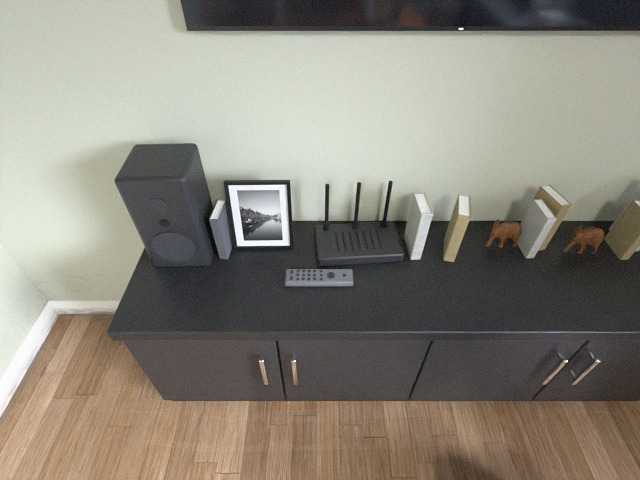

# SpatiotemporalBench 0.11.0: technical report

Version 0.11.0 (2026-10-16) · code:
[DanMcInerney/SpatiotemporalBench](https://github.com/DanMcInerney/SpatiotemporalBench) · data:
`DanMcInerney/spatiotemporalbench` on Hugging Face, revision `v0.11.0`

> The reference rows are Claude models; 0.10.0's rows were Codex models and are in
> [history/report-0.10.0.md](history/report-0.10.0.md). What 0.11.0 changes is in the [CHANGELOG](../CHANGELOG.md),
> [methodology.md](methodology.md) (rules 4, 5 and 7) and [question-design.md](question-design.md) (sections 1, 2, 3, 5,
> 6 and 8).

This report goes deeper than the [README](../README.md). It covers what 0.11.0 measures and, as plainly, what it does
not; how it scores; which questions it asks and why; what three reference models and a scripted floor scored; whether
the design did what it set out to do; how validity is checked; and where the benchmark stops. 0.11.0 keeps the renders
of 0.7.0 to 0.9.0 and compiles them again, as 0.10.0 did: the agent pulls one frame at a time, and the questions are the
decisions each robot's brain faces. The reference models are Claude models in 0.11.0. The report of 0.10.0, whose
reference rows were Codex models and whose questions and credit this release changes, is kept in
[history/report-0.10.0.md](history/report-0.10.0.md), that of 0.9.0 in [history/report-0.9.0.md](history/report-0.9.0.md)
and that of 0.7.0 in [history/report-0.7.0.md](history/report-0.7.0.md). Every number comes from the release's compiled
data and result files, or from a review or a measurement of the data named where the number stands. The tables of
results and gates are pasted from the outputs of `stbench eval` and `stbench check` by `tools/fill_report.py`; the few
figures no tool prints (the age bands and the catastrophes pooled over places, the full-credit shares and the family
slices by job) were counted from each run's rows.

**In short.** A simulated robot does a real job in a photoreal place. Its camera frames reach the agent one at a time,
each with the robot's pose, its own velocity, the clock and its status, and no depth; the agent asks for the next frame
when it is done with the last. It is asked the decisions the robot's job depends on, harm first: how far its body could
move before it touched anything, how close the person nearest it would come in the next 5 seconds, what lies on the
floor that its brush could catch. Then come the questions about what it saw before: where things are from it, in view and
out of view, and where on the map it last saw them. Code checks each answer against the simulator's record and credits it
in four quarters by what its error would do to the job, and an answer whose action would have ended in harm is charged a
flat penalty in the reported score. 0.11.0 measures perception and memory. It does not test change over time: no job asks
what moved, appeared or went since an earlier pass, or where a moving person is going (Section 7). On 42 of the 124 short
and medium cases that ask a question (Section 4 says why 42), `claude:haiku` (medium) scores +0.152 [+0.076, +0.250] on `apartment_a`, +0.185 [+0.019, +0.325] on `downtown_a`, +0.273 [+0.112, +0.440] on `warehouse_a`; `claude:sonnet` (medium) scores +0.286 [+0.159, +0.404] on `apartment_a`, +0.366 [+0.213, +0.505] on `downtown_a`, +0.307 [+0.077, +0.499] on `warehouse_a`; `claude:opus` (medium) scores +0.567 [+0.518, +0.642] on `apartment_a`, +0.614 [+0.517, +0.717] on `downtown_a`, +0.419 [+0.188, +0.638] on `warehouse_a`; the floor
scores `apartment_a`: `all_unknown` (rgb_pose) +0.034 [+0.019, +0.048]; `downtown_a`: `all_unknown` (rgb_pose) +0.132 [+0.078, +0.219]; `warehouse_a`: `all_unknown` (rgb_pose) +0.056 [+0.000, +0.125]. These are dev rows: the questions were
refined on the shifts they are scored on, and nothing is held out.

## 1. What is measured, and the setup

The agent acts as the robot's onboard brain and is asked what a controller asks itself. The questions are decisions, and
they fall into four kinds (the vision's, [vision.md](vision.md)): **harm**, what an action now would hit, tangle on or
endanger; **help**, which action now best moves the task forward; **situation**, what is around the robot, in view and out
of view; and **reuse**, what is worth remembering to do the job here again. Each question is also one of the abilities
below, which decide the headline's cells.

| Ability | A controller asks itself | Column |
| --- | --- | --- |
| Distance | "Where is the nearest part of that drum I can see, from me, now?" | `now` |
| Memory | "Where, as I last saw it, is the red bin from where I am?" "Where did I last see the laundry basket?" "Which way do I set off to reach the router I saw?" (0.11.0) | `memory` |
| Task relevance | "What stood within 2 m of the way I drove?" | `memory` |
| Clearance | "If I drove straight ahead, backed up or turned and drove, how far could my body go?" "How close would the person nearest me come in the next 5 s?" "How close would the person I saw last, now out of view, come?" "How close did a person come?" "What on the floor could my brush catch?" "Which way gives my body the most room?" (counted since 0.11.0) | `now` or `memory`, by what answers it |
| Knowing what it does not know | `unknown` when the sensors never showed the answer | in every question |

**What is not measured.** Change over time is not tested. 0.11.0 measures where things are now, and where things the
robot saw earlier are, from seconds to hours before. The change families are built (`same_place`, `object_was` and
`changed`) and no job asks one: the world changes only between tasks, and the data hold too few changes that the robot
saw on both sides to ask a fair question about (Section 7). Anticipation is untested for the same reason. Control, free
text and the inside of a memory system are not measured either ([methodology.md](methodology.md), section 1). Help is
counted since 0.11.0: `open_heading` is a clearance question and `way_to` a memory question. Only `prediction`, which
no job asks, is a diagnostic ability.

| Job | Robot | Camera height and pitch | Place | One task |
| --- | --- | --- | --- | --- |
| `vacuum/2` | robot vacuum, a 34 cm disc | 0.08 m, fixed, 5° up | `apartment_a` | cleans one or two rooms |
| `helper/1` | Stretch-class home helper | 1.30 m, tilts from 60° down to 20° up | `apartment_a` | carries a thing from a surface in one room to a surface in another |
| `amr/1` | MiR250-class tote robot | 0.50 m, 10° down | `warehouse_a` | docks at tote shelves and packing tables, or runs a picking loop |
| `drone/1` | Wing-class tether delivery drone | under the body, 20° to 90° down; cruises at 15 m, lowers from 7 m | `downtown_a` | flies to a drop point, inspects it, lowers a package |

Every camera gives a 640 × 480 JPEG with an 80° horizontal field of view, a focal length of 381 pixels. Nothing is
labelled and no depth is sent: the agent estimates every distance from the pixels. Each frame has one header line with
the step and clock, the base's position and heading in map metres, the robot's own velocity, the camera's pitch, the
robot's status and its subgoal. The reference agent's prompt also states the robot's body, so that "how far could your
body go" has an answer.



*A frame as the agent receives it: the helper's camera, 1.30 m up and pitched 45° down.*

**One frame at a time, pulled by the agent** ([agent.md](agent.md); [codex.md](codex.md), "How a run goes"). 0.9.0 sent
up to 8 frames in a message, cut after every decision point. 0.10.0 sends exactly one frame in each `observe`, and the
reply to it is the request for the next: the harness sends nothing until the reply has come, so the agent sets the pace.
- `now` is the latest frame. A question is `now` only when the frame the agent holds when asked gives its gold alone;
  what needs an earlier frame is `memory` ([methodology.md](methodology.md), rule 4).
- The robot's own velocity is in every step (`velocity`, `[vx, vy]` in metres a second, the controller's odometry), so a
  system need not difference two poses.
- The reference agent holds one session for the whole case, a Codex thread or a Claude Code process
  ([claude.md](claude.md)), and pulls its frames inside it with `next_frame`; it answers with `submit_answer`. One long
  session is kept because a Codex turn waits about 12 to 13 s for its first token however small the message, while a
  request after a tool result inside a turn took about 3 to 5 s.
- A frame and its questions arrive together, so the model looks and decides in one round trip. Several questions at one
  point are asked one at a time, so a later question's wording cannot inform an earlier answer.
- Nothing in the stream marks where a decision point falls. The old batch rule is the question compiler's look window,
  and a system never sees one.

**Shifts and cases.** The renders are those of 0.7.0 to 0.9.0: no frame was rendered for 0.10.0 or 0.11.0, and the scripts are
compiled again into cases. A shift is 2 to 6 tasks of one job. Between tasks the robot is parked and unobserved for 10
minutes to 3 hours, and the place changes: things move, doors open and shut, people come and go. A case is a window of a
shift, streamed from step 0 on a fresh clock: `short` (1 task), `medium` (2 or 3) or `long` (4 to 6). The reference rows
run the short and medium cases. **Counts** in the compiled data, from the release's `release.json`:

| Job | Place | Scripts | Cases (short / medium / long) | Questions | Frames |
| --- | --- | --- | --- | --- | --- |
| `vacuum/2` | `apartment_a` | 16 | 16 / 16 / 4 | 711 | 6,460 |
| `helper/1` | `apartment_a` | 16 | 16 / 16 / 4 | 541 | 3,157 |
| `amr/1` | `warehouse_a` | 16 | 16 / 16 / 4 | 245 | 4,679 |
| `drone/1` | `downtown_a` | 16 | 16 / 16 / 4 | 264 | 2,534 |

In all, 64 shifts were rendered once and compiled into 144 cases of
16,830 frames, with 1,761 questions.

| Kind | Family | Ability (column) | When | It asks | Answer |
| --- | --- | --- | --- | --- | --- |
| Harm | `clear_path` | clearance (`now` or `memory`) | during | how far the body could move before it touched anything: ahead, back, or after turning in place left or right | number |
| Harm | `closest_approach` | clearance (`now`; `memory` when the person walks) | during | how close the person it can see nearest would come in the next 5 seconds, if both kept their velocity | number |
| Harm | `approach_mem` | clearance (`memory`; 0.11.0) | during | how close the person it saw last, now out of view, would come in the next 5 seconds if it kept the velocity it has (AMR, helper) | number |
| Harm | `tangle_ahead` | clearance (`memory`, or `now` when one frame shows every item) | during | what lies on the floor within 1 m, ahead or to the sides, that the brush could catch | a list of map points |
| Harm | `closest_person` | clearance (`memory`) | after the job | how close a person came during a task, as the robot saw them | number |
| Help | `open_heading` | clearance (`now` or `memory`; counted since 0.11.0) | during | which heading, turned in place, would let the body go farthest | heading |
| Help | `way_to` | memory (`memory`; 0.11.0) | during | which way to set off to reach a thing seen before, by the shortest way the body fits through the floor it has seen (helper) | heading |
| Situation | `ego_now` | distance (`now`) | during | where the nearest visible point of a thing in view is, from the camera, along the floor | offset |
| Situation | `ego_mem` | memory (`memory`) | during | the same for a thing seen before the last 8 frames of the task and not in them, from where the camera is now | offset |
| Reuse | `object_where` | memory (`memory`) | after the job | where on the map it last saw a thing | a map point |
| Reuse | `task_things` | relevance (`memory`) | after the job | where the things near its task were, by the job's rule: on the floor within 1.2 m of its way (helper), within 2 m of its drive (AMR), the things on the floor of the rooms it cleaned that its brush could catch (vacuum; 0.11.0) | a list of map points |

Two more families are built and asked by no job: `drop_zone_people` (who stands within 4 m of the point below the drone), for
want of supply, and `person_mem` (where a person last seen is, once out of view), which failed a gate on the helper
([families/drop_zone_people.md](families/drop_zone_people.md), [families/person_mem.md](families/person_mem.md)).

**Look points** ([question-design.md](question-design.md), section 5; [questions.md](questions.md), "Look points"). A look
family is asked right after a frame, and the frame can be any frame of the case:
- the candidates are the frames at least 4 steps into their task, except its last frame;
- the frames of each job's priority decisions come first in the draw (before a crossing, a station, a grasp, a doorway, a
  lowering, a room done), then the rest, each in a hash order of the case id and the frame;
- a frame is kept when it is at least 4 frames from every frame kept, until the case holds one point for every 6 frames.

A point asks one question for each of up to three slots, filled harm first. Each slot draws its family from a table the
job declares, as a percent of points. The vacuum and the AMR are asked only about things on the floor (`World.on_floor`):
a mug on a table is no obstacle to a vacuum.

| Job | Slot 1 (harm) | Slot 2 (what it saw before) | Slot 3 (the rest) | After the job |
| --- | --- | --- | --- | --- |
| `vacuum/2` | `clear_path` 50, `tangle_ahead` 50 | `ego_mem` 100 | `open_heading` 20 | `object_where`, `task_things` (0.11.0) |
| `helper/1` | `clear_path` 50, `closest_approach` 50 | `ego_mem` 65, `way_to` 35 (0.11.0) | `ego_now` 20, `open_heading` 15, `approach_mem` 30 (0.11.0) | `object_where`, `task_things` |
| `amr/1` | `closest_approach` 100 | `ego_mem` 100 | `ego_now` 50, `approach_mem` 50 (0.11.0) | `task_things`, `closest_person` |
| `drone/1` | `clear_path` 60 | `ego_mem` 70 | none | none |

The draw reads the case id, the plan and the table, never the world, a gold or an answer, so which question is asked
reveals nothing about what is in view. The `clear_path` direction is drawn the same way (ahead, back and left for the
vacuum; ahead, back, left and right for the helper; ahead and back for the drone). The end questions come together in one
ask after the last frame. Some questions have `unknown` for answer, in the same words as the rest: those about a thing, a
corridor or a patch of floor the robot never saw.

The questions by job and family, and the share of each family's golds that is `unknown`, counted from the release's
`gold.jsonl`, are the `n` and `Unknown share` columns of the gate table in Section 6.

## 2. Scoring

**The need is the job's.** What an error costs is set by what the job needs to act on the answer. Where a thing or a
person is from the camera, how far the body could move, how close a person came or would come, and a heading are credited
against the job's clearance C, the margin the robot's own operating spec keeps beside its path to the things it meets. A
place on the map is credited against the re-find radius R, within which the robot, driving back, finds the thing again
with it in view. A list is credited against its matching radius M.

| Job | C | R | M | Source of C |
| --- | --- | --- | --- | --- |
| `vacuum/2` | 0.10 m | 1.0 m | 0.5 m | the loose end of what camera vacuums aim to pass beside an obstacle |
| `helper/1` | 0.15 m | 1.0 m | 0.5 m | OWMM-Agent counts a pick when the end-effector is within 0.15 m of the target |
| `amr/1` | 0.45 m | 1.0 m | 1.0 m | the MiR250's specification: a 580 mm robot needs a 1,450 mm corridor, 0.435 m a side |
| `drone/1` | 2.4 m | 2.0 m | none | Wing's patent US12399508B2: a delivery point at least 8 ft from trees and 10 ft from buildings |

C is never a detection size, a docking or placement precision, or a facility-layout rule. The sources of R and the
sources rejected for C are in the report of 0.9.0, section 2 ([history/report-0.9.0.md](history/report-0.9.0.md)). The
values were fixed before 0.7.0's first run, have not moved since, and are stated in the prompt in metres and centimetres.

**Four quarters.** An answer that is `e` off the gold earns a credit `s` that is the mean of four quarters, one for each
layer of the vision, against the need N and the gold's resolution ρ, the error of one pixel of the camera at the
geometry the gold rests on, at least 1 cm (written into every gold row, `tolerances.resolution_m`). The need that the
quarters are measured on is **N' = max(N, 0.1 g, 2ρ)** (0.11.0), where g is the distance the answer is judged over: a
number's gold value, an offset's range from the camera, a heading's best run, or the step R of a route. So within ten
needs of the robot the need is the job's own, and beyond that it is a tenth of the distance, the same for every robot,
where 0.10.0 widened it to whatever two pixels of the robot's own camera resolved. A place and a list item keep R and M.
The arithmetic is `credit_kernel` ([questions.md](questions.md), "Credit").

| Quarter | It is earned by | Whole | Falls to nothing |
| --- | --- | --- | --- |
| Direction | the right side, the right order, blocked or clear | on the right side | a step, 0 or 1 |
| The right thing or action | being near the gold | within 2N' | at 4N', linearly |
| The right amount | being within what the job needs | within N' | at 2N', linearly |
| Precision | being as exact as the camera can resolve | within ρ | at N', log-linearly in e / ρ |

The direction is decided by the answer's type: for an offset, a bearing within 45° of the gold's, or an error within N;
for a distance in metres, the same side of T, the body's length plus C (for a corridor, whether there is room to move at
all) and, where the gold is at least T, within a factor of two of it; for a place, within R; for a heading (`open_heading`),
room to move: a run of T or longer, or the best run less a pixel where no heading has that much (through 0.10.0, a run at
least half the best); for the way to a thing (`way_to`), having an outcome (below); for a list item, being within M of the thing it is matched to (0.11.0). The curve is continuous and strictly falling between ρ and 4N',
and its one step is the direction quarter, so no answer coarser than a pixel earns the whole. An answer with credit `s`
scores `2s - 1`:

| The answer | Credit | Score |
| --- | --- | --- |
| within one pixel of the gold (ρ) | 1 | +1 |
| at N | 3/4 | +0.5 |
| at 2N | 1/2 | 0, as good as `unknown` |
| at 4N or beyond, the direction right | 1/4 | -0.5 |
| beyond, the direction wrong | 0 | -1 |
| `unknown`, where the frames hold the answer | | 0 |
| `unknown`, where nothing the robot sensed answers | | +1 |
| anything else, where nothing the robot sensed answers | | -1 |
| a catastrophe, in the reported score only (below) | | minus its weight, 2 or 3 |

An answer beats `unknown` when it is within twice the need, and the prompt says to answer only when more likely right
than wrong: knowing one's own precision is part of the ability.

**Harm costs more than caution.** On the harmful side the need (N and the tenth of the distance) is halved, in all three
of its quarters, and 2ρ is not: a clearance answered longer than the gold (more room than there was), a closest approach
answered wider (a person who came closer than said), an offset whose error points away from the camera along the gold's
bearing (a thing or a person placed farther than it is), and a heading whose run is under T (for `way_to`, a heading with
no outcome). A cautious error of 2N and a harmful one of N leave the robot the same margin. A place to re-find a thing
has no harmful side.

**A decision scores by its regret** (0.11.0 for both). An action, a heading, is credited by what it gives up against the
best one, in the same four quarters on the same need rule. For `open_heading` the regret is the best run less the
answered heading's run in metres, with g the best run. For `way_to` it is the progress along the heading: how much nearer
to a thing it saw before one R of driving along the heading brings the robot, by the shortest way its body fits through
the floor it has seen or driven, against the best heading's. A heading with less room than the body needs, or into floor
never seen, has no progress, no direction and the harmful side: it scores -1, so a wrong doorway costs its whole regret.
On the helper the need the route is credited on is 2ρ = 0.2 m, the field's 0.1 m cell doubled.

**A catastrophe is charged in the reported score only** ([question-design.md](question-design.md), section 6;
[methodology.md](methodology.md), rule 7). It is an answer whose action would end in harm, by a harmful error larger than
`max(C, 2ρ)`. Whatever credit it earned, it scores minus a flat weight, declared once in `credit_kernel` with its reason
and never tuned to a score:

| Family | An answer is a catastrophe when | Weight |
| --- | --- | --- |
| `clear_path` | the true corridor is under the body's length plus C (there was no room to move) and the answer is at or over it | 2: contact with a thing the robot saw |
| `closest_approach`, `approach_mem`, `closest_person` | a person came inside the body's length plus C and the answer says they stayed outside it | 3: contact with a person |
| `tangle_ahead` | the list leaves out a thing within 0.3 m of the body's front edge | 3: a hazard of the robot's own kind, a tangle |

An overstated corridor with room to spare is a wrong answer and no collision, so it is not a catastrophe, and `unknown`
never is. The reference agent's prompt states the weights, built from the same constants.

**Two scores.** The **gate score** is the penalised score `2s - 1` with no catastrophe term: every gate, the `knowable`
check, the evidence verdict and the leak check read it (a result row's `score_gate`). The **reported score** is the same
except for a catastrophe, and it is the one the headline, the reports and the reference rows read (the row's `score`). A
weight inside a gate would lower every shortcut that guesses, so a family could pass a gate because of the weight and not
because the sensors are needed; the design review measured it ([question-design.md](question-design.md), section 6).

**Worked examples,** worked with the scorer from made-up golds to show the arithmetic; they are not rows of any run. The
helper (C = 0.15 m, a body 0.34 m long, so T = 0.49 m) is asked how far its body could move straight ahead. The gold is
0.30 m, under T: there is no room to move. One pixel there is ρ = 5 cm.
- The answer 0.45 m is on the same side of T (direction 1) and 15 cm too long, the harmful side, so N = 7.5 cm widens to
  2ρ = 10 cm: the thing quarter is 1, the amount quarter 0.5 and precision 0. The credit is 0.625 and the score +0.25.
- The answer 0.20 m is 10 cm short, the cautious side: N stays 15 cm, the credit is 0.84 and the score +0.68.
- The answer 1.0 m says there is room to move, the wrong side of T: credit 0 and a gate score of -1, where `unknown`
  scores 0. It is also a catastrophe, an answer over T where the gold is under it by more than max(C, 2ρ) = 15 cm, so its
  reported score is -2. Asked how close the nearest person would come, with a gold of 0.40 m inside T, the answer 2.0 m
  is the same error with weight 3: a gate score of -1 and a reported score of -3.

**The headline** is the mean of two columns that count equally, whatever their numbers of questions: `now`, the cells the
latest frame answers, and `memory`, the cells that need what the robot saw before. Inside a column the cells, each an
ability in that column pooled over its own questions (a ratio of sums), are averaged by their weights (below). Clearance
has a cell in each column, by the evidence that answers each row. Each place's mix differs, so its columns hold:
- the **apartment** (the vacuum and the helper): `now` is distance (the helper's `ego_now`) and clearance (corridors,
  headings and cords that one frame answers); `memory` is memory (`ego_mem`, `object_where` and `way_to`, pooled),
  relevance (`task_things`, the helper's and the vacuum's) and clearance (what needs memory);
- the **warehouse**: `now` is distance (`ego_now`) and clearance (`closest_approach` on a person who stands, or on no
  one); `memory` is memory (`ego_mem`), relevance (`task_things`) and clearance (`closest_person`, and a person who
  walks);
- **downtown**: `now` is clearance, the drone's corridors in view; `memory` is memory (`ego_mem`) and clearance, the
  corridors that need memory.

A (job, ability, column) cell weighs `min(1, n / 20)` for its `n` questions in the whole dataset (0.11.0). A cell's mean
pools its rows by their weights, a cell weighs in its column the largest weight of its rows, and a column weighs in the
headline the largest weight of its cells. Through 0.10.0 a cell of fewer than 20 questions was a diagnostic, shown and
counted in no mean, which flipped cells in and out between compiles; a dataset whose cells all hold 20 or more is
unweighted, and every score of a release takes the dev root's cells (`--cells-from`). Only `prediction`, which no job
asks, is a diagnostic ability, shown and counted in no mean. There is no own-path column: the pose and status are given, so the robot's own
path is a log lookup and is never asked. Intervals are 95% percentile bootstraps over shifts (2,000 resamples), each
resample recomputing the abilities, the columns and the headline. No number pools places. Beside each headline the reports
give the unpenalised mean credit, the share of answers in each credit band, the abstention bound, and three things that
are not cells of the headline: the split by kind (harm, help, situation and reuse), the catastrophe rate (the share of the
harm rows answered that are catastrophes, for each job), and the score by the age of the evidence (0.10.0). Each gold row
records `age_s`, the clock seconds from its oldest evidence frame to the ask, and `age_band`: `now` (the latest frame
alone gives the gold), `recent` (memory, up to 10 s), `task` (older, in the task the question falls in) or `earlier` (in
an earlier task); both are null on an `unknown` row. The score by band is a memory curve: credit against how long ago the
robot saw the answer ([question-design.md](question-design.md), section 1).

**Why the target is the nearest visible point.** A ground camera sees a thing's near face, and the middle sits behind it,
so an offset names the point of the thing's floor hull nearest the floor point under the camera, which a pixel-perfect
reader reproduces exactly. A place (`object_where`, an item of `task_things` or `tangle_ahead`) names the middle of the
thing where it stood, a place to drive back to; the prompt says which point each answer names. The 0.7.0 report measured
the choice ([history/report-0.7.0.md](history/report-0.7.0.md), section 2).

## 3. Which questions are asked, and why

**Every question is a decision.** The robot's brain faces four kinds of decision in its job, and each robot's real job
decides what is asked of it ([question-design.md](question-design.md), section 2, has the table for each):
- **The vacuum** steers round floor obstacles, backs out and turns when cornered, and stops until a person frees it when a
  cord winds round its brush. *Harm:* how far it can drive on, back out or turn away (`clear_path`), and what lies within
  a metre that its brush could catch (`tangle_ahead`). *Help:* which way gives it room (`open_heading`). *Situation:*
  where the things on the floor it passed are from it now. *Reuse:* where it last saw a thing, and (0.11.0) the list of
  the things on the floor of the rooms it cleaned that its brush could catch, which it would have to steer around next
  time (`task_things`).
- **The home helper** drives to a thing, carries it, backs away from counters and turns in tight rooms, and shares the
  home with a resident. *Harm:* how far its body can go before it touches a table edge, a chair or a console, and how
  close the resident would come in the next few seconds (`closest_approach`). *Help:* which way gives it room
  (`open_heading`), and (0.11.0) which way to set off to reach a thing it saw (`way_to`). *Situation:* where things are,
  in view and out of view. *Reuse:* where things are kept, and what stood on the floor of its routes.
- **The AMR** carries totes between stations in aisles it shares with pickers, and must stop before a person in its path.
  *Harm:* how close the person nearest it would come (`closest_approach`), and how close one came during a task
  (`closest_person`). *Situation* and *reuse:* where the things on the floor were, and what stood within 2 m of its route.
  Its corridors are mostly the 5 m cap in open aisles, so it has no corridor or help question its sensors decide.
- **The drone** flies between its nest and a drop zone at 7 to 15 m and must not meet a building. *Harm:* how far it can
  fly ahead or back at its height. *Situation:* where the ground things it saw are from it now. It asks nothing about the
  people below it, for want of supply, and nothing after the job.

The strongest questions need what is in view now, what was seen before and whether it has changed since. 0.11.0 asks the
first two and not the third (Sections 1 and 7). Some ask about actions toward space the robot cannot see now, which only
memory answers: the corridor behind the robot or round a corner it has turned, the cord beside it that it passed frames ago.

**More questions, asked at decisions.** The frames are a case's fixed cost, and a question costs far more than a frame:
the reference agent takes about 1 to 3 s to look at a frame and tens of seconds to answer a question. 0.9.0 asked its
short and medium cases one question in about 30 frames, so a case streamed all its frames to ask a handful of questions
([question-design.md](question-design.md), section 5). The vision's "Speed" section is amended accordingly: a case may ask
as many fair questions as its frames support within its time ([vision.md](vision.md)). A case now asks about one question
in every 9 to 25 frames, by job (the same section has each job's density, and the supply that limits the AMR). The slot
tables of Section 1 put harm first at every point, and the frames of each job's priority decisions come first in the draw,
so the questions are asked where a controller would ask them. Asking more, and asking at decisions, has a cost the design
measures and does not hide:
- **Cueing.** A question that names a thing makes it salient. So no subject is asked twice in a case, wording comes from
  fixed templates, and the leak check of Section 6 measures how much asking during the job changes later answers.
- **A decision frame shows itself.** A question being asked can show that a frame is one of the robot's decision moments.
  The robot's status and subgoal already show that, and the plan alone decides where they fall, so for a family whose
  answer depends on the world at that moment it is harmless. For a structure family it was a channel: the final review of
  the branch found that a decision frame puts a corridor question at the same plan pose, by the same furniture, in every
  script, and a prior of other scripts' answers learned the helper's corridors. The helper's `before_place` frames left the
  decision frames, and the evidence verdict passes (Section 6).

**New in 0.10.0,** with the pages that hold the gold and the reasoning:
- **`closest_approach`** (AMR, helper; [families/closest_approach.md](families/closest_approach.md)): the least floor
  distance over the next 5 s between the point below the camera and the nearest person, if each kept the velocity they
  have, capped at 10 m. It is the decision a planner makes about a person: the AMR's slows or yields when a person would
  come within its protective field. A person's motion counts only where the sensors pair their sightings (exactly one
  evidence person in the ask's frame and in the earlier frame used), and otherwise the point is a dead band.
- **`tangle_ahead`** (vacuum; [families/tangle_ahead.md](families/tangle_ahead.md)): the cords and cloths on the floor
  within a metre ahead or to the sides, as a list of places. Bath mats, pedestal mats and clothes piles recur at the same
  spots from script to script, so they are don't-care circles and never items.
- **The robot's own velocity** in every step, which makes a `closest_approach` row whose person stands a `now` row, and
  **floor things only** for the floor robots, so that a thing's kind does not predict the slice.

**New in 0.11.0** ([CHANGELOG](../CHANGELOG.md); the pages are [families/way_to.md](families/way_to.md) and
[families/task_things.md](families/task_things.md)):
- **`way_to`** (helper): which way to set off to reach a thing it saw before, a heading credited by the progress along
  it through the floor the robot has seen or driven (Section 2).
- **The vacuum's `task_things`**: the list of what its brush could catch in the rooms it cleaned, with the kinds that
  recur at one spot from shift to shift don't-care, as in `tangle_ahead`.
- **`approach_mem`** (AMR and helper): how close the person last seen, now out of view, would come to the robot in the
  next 5 seconds if it kept moving as it is ([families/approach_mem.md](families/approach_mem.md)). It needs memory of a
  person, a thing in no layout, composed with the robot's own motion. The AMR's slot 3 gives it half of `ego_now`'s, and
  the helper's slot 3 gives it 30 of the 65 points it drew nothing on.
- **A list item is a place, and the empty list is graded.** A list item earns its direction quarter within the match
  radius M of the thing and nowhere else, as a place does within R, and an empty gold's list scores
  `1 / (1 + 0.5 |false|)` where any false place scored 0 through 0.10.0
  ([question-design.md](question-design.md), section 6).
- **`open_heading` counts**, and every distance is scored on the one need rule of Section 2.
- **A prompt sentence** that a question may name a thing never shown clearly or not there (then `unknown` is right), and
  a screen that drops an `unknown` question whose window glimpsed a look-alike in the asked colour.

**Dropped by rule.** A family that fails a gate is repaired as a broken instrument or dropped from its job, never forced or
tuned ([question-design.md](question-design.md), sections 3 and 9):
- **`person_mem` on the helper.** On the first 0.10.0 compile 7 of its 19 questions were answerable and 12 had an
  `unknown` gold, so a perfect reader led a blind `unknown` by exactly the answerable share, +0.368, against the gate's
  0.4. It was dropped and not re-tuned. Where a person who has left the view is now goes unasked: an open gap.
- **`drop_zone_people` on the drone.** It drew 2 questions over the 36 development drone cases, under the 20 a full cell
  needs, in a cell shared with other families, so the final review took it off the drone.
- **0.9.0's drops** (a place's room as direction credit; the vacuum's `task_things` returned in 0.11.0, above) stand
  ([history/report-0.9.0.md](history/report-0.9.0.md), section 3).

**Not asked, and why** ([question-design.md](question-design.md), section 3, has the full list):

| Not asked | Why |
| --- | --- |
| What was moved, added or removed since an earlier pass | `changed` failed on layout priors: most of the vacuum's golds were the empty set, which the current view and the question's form guess. The supply of observed change is too small for any other change question (Section 7) |
| Questions at the start of a task | Only the vacuum has a task that carries on earlier work, and the blockers on a route to the dock are a layout prior |
| The task's own target, a blocked bay's blocker | The brief, the subgoal and the robot's response tell it (`World.told`) |
| The drone's `closest_approach` | A floor distance from a camera 15 m up is not the drone's harm decision |
| The AMR's corridors; `open_heading` for the AMR and the drone | Most of the AMR's golds are the 5 m cap, its best run is always the cap, and the open high street is the longest run from every point of the drone's square |
| A drone family on this data (`approach_mem` at the drop, the drop clearance, a people list, `way_to` or `open_heading`, vehicles, change between flights) | The people near the drop points stand at layout spots (639 of 643 dwell places within 2 m of another script's), a remembered person at the drop scores +0.42 with a constant and a drop clearance +0.34, and flight routes are fixed by the map ([question-design.md](question-design.md), section 3) |
| Answers with uncertainty; weighting harm in the headline | `unknown` stays the one way to say the sensors did not show the answer, and harm costs more row by row, through the harmful side and the catastrophe term |

**Two structure families.** How far the body could move and which way has the most room depend partly on the place's fixed
structure, and the maps are public. The agent is never given a map, so it perceives and remembers the structure, and the
fixed structure around the robot is asked ([methodology.md](methodology.md), rule 5). Every case starts a fresh agent that
has never seen the place. A score on these questions is a claim about a system that holds no copy of the map, and a
held-out place would make it a claim about every system. The **map reader**, which answers each corridor and heading from
the public floor plan, is an internal design diagnostic in `stbench check`: a new family must put a system that holds the
layout near the floor, and no results table carries its rows. Only `clear_path` and `open_heading` are structure
families; making another needs the rule amended.

**The screens** of 0.7.0 and 0.9.0 stand: a question is asked only where a careful reader of the frames could answer it
within the job's accuracy, and never where the words or the place give it away (a thing is recognisable, has no look-alike
sighted in its colour, ties to a surface a reader with no depth can read, and does not move after it was seen; a
corridor's stopper is tied to a floor contact the camera can read to within C/2). Each screen reads the timeline and the
cameras, never a gold or a score, and removes questions without adding any. They are in
[history/report-0.9.0.md](history/report-0.9.0.md), section 3, and [questions.md](questions.md), "How a gold is computed".
A person is evidence at 1,024 pixels with the feet tied to the floor, and a frame that shows someone it cannot place is a
dead band for `closest_approach`.

**The questions over the releases,** on the same cases: 0.6.0 asked 1,009, 0.7.0 785 and 0.9.0 668. 0.10.0's compile
holds 1,701, asked at far more points of each case, and 0.11.0's 1,761.

## 4. Results per place

These rows are 0.11.0's: Claude models, run on 0.11.0's questions and prompt and scored by 0.11.0's scorer. **The
reference models changed from Codex to Claude** in this release: the harness runs both agents the same way
([claude.md](claude.md)), so 0.11.0's rows are three Claude models. 0.10.0's rows were three Codex models (astra, sol and
luna) on 0.10.0's questions. They are in [the report of 0.10.0](history/report-0.10.0.md), and the same stored answers
scored by 0.11.0's scorer are in the [CHANGELOG](../CHANGELOG.md). The two sets of rows differ in the models, the
questions, the prompt and the scorer, and this report does not compare them.

The reference agent is the same agent as 0.10.0's, reached through the Claude Code CLI on a Claude Code login
([claude.md](claude.md); [codex.md](codex.md) describes what the two share). A case is one `claude -p` process. Its two
tools are `next_frame`, the robot's sensor feed, and `submit_answer`, and it has no memory tool: its context is its
memory, and Claude Code compacts it itself. Its prompt states the camera model, the robot's body, C, R, the four quarters
of the credit, the halved margin on the harmful side, the weights of a catastrophe, how a list and a heading are credited
and what point each answer names. The rows use the camera channel (`rgb_pose`), the correct brief and the during
questions. Haiku (`claude:haiku`), sonnet (`claude:sonnet`) and opus (`claude:opus`) ran at medium effort, once each. The
floor, `all_unknown`, answers `unknown` to everything.

**The rows cover 42 of the 124 short and medium cases that ask a question** (20 apartment cases, 11 warehouse and 11
downtown; 21 short and 21 medium). Every system ran the same 42, the same cases as 0.10.0's rows. Those were the cases
0.10.0's three models had finished when those runs stopped: the first 45 cases by id, less 3 that astra had not
started. The order the runs took them chose them, and no outcome did. The intervals are wide for it,
and rows on every case are left for a later revision.
Coverage: `all_unknown`: 42 of 42 cases; `claude:haiku` (medium): 42 of 42 cases; `claude:sonnet` (medium): 42 of 42 cases; `claude:opus` (medium): 42 of 42 cases.

| Layout | System | Headline (95% interval) | `now` | `memory` | Cases scored |
| --- | --- | --- | --- | --- | --- |
| `apartment_a` | `claude:haiku` (medium) | +0.152 [+0.076, +0.250] | +0.120 [+0.012, +0.276] over 41 | +0.184 [+0.102, +0.275] over 215 | 20 |
| `apartment_a` | `claude:sonnet` (medium) | +0.286 [+0.159, +0.404] | +0.254 [+0.055, +0.435] over 41 | +0.317 [+0.210, +0.407] over 215 | 20 |
| `apartment_a` | `claude:opus` (medium) | +0.567 [+0.518, +0.642] | +0.589 [+0.521, +0.705] over 41 | +0.544 [+0.430, +0.663] over 215 | 20 |
| `apartment_a` | `all_unknown` | +0.034 [+0.019, +0.048] | +0.000 [+0.000, +0.000] over 41 | +0.067 [+0.037, +0.097] over 215 | 20 |
| `warehouse_a` | `claude:haiku` (medium) | +0.273 [+0.112, +0.440] | +0.420 [+0.235, +0.593] over 24 | +0.127 [-0.062, +0.325] over 40 | 11 |
| `warehouse_a` | `claude:sonnet` (medium) | +0.307 [+0.077, +0.499] | +0.360 [+0.028, +0.652] over 24 | +0.254 [-0.008, +0.486] over 40 | 11 |
| `warehouse_a` | `claude:opus` (medium) | +0.419 [+0.188, +0.638] | +0.501 [+0.276, +0.699] over 24 | +0.338 [-0.002, +0.686] over 40 | 11 |
| `warehouse_a` | `all_unknown` | +0.056 [+0.000, +0.125] | +0.000 [+0.000, +0.000] over 24 | +0.111 [+0.000, +0.250] over 40 | 11 |
| `downtown_a` | `claude:haiku` (medium) | +0.185 [+0.019, +0.325] | +0.109 [-0.079, +0.318] over 22 | +0.261 [+0.008, +0.467] over 46 | 11 |
| `downtown_a` | `claude:sonnet` (medium) | +0.366 [+0.213, +0.505] | +0.380 [+0.201, +0.586] over 22 | +0.351 [+0.111, +0.534] over 46 | 11 |
| `downtown_a` | `claude:opus` (medium) | +0.614 [+0.517, +0.717] | +0.596 [+0.463, +0.788] over 22 | +0.632 [+0.506, +0.781] over 46 | 11 |
| `downtown_a` | `all_unknown` | +0.132 [+0.078, +0.219] | +0.000 [+0.000, +0.000] over 22 | +0.263 [+0.156, +0.438] over 46 | 11 |

How to read the rows:
- **The floor's `memory`** is the mean, over the memory cells, of the share of each cell's questions that have `unknown`
  for answer, which scores +1 for it. Its `now` is 0 where every `now` question has an answer in view.
- **Each column is a mean of cells.** The cells of each place's columns are in Section 2. A cell with its questions and an
  interval is in the comparison below, one line for each (ability, column) and for each family. A cell with fewer than 20
  questions on a job weighs `n / 20` of a full cell; only `prediction`, which no job asks, is a diagnostic ability and
  counts in no mean.
- **`open_heading` and `way_to` count.** `open_heading` is a clearance cell and `way_to` a memory cell (Section 2).
  0.10.0 reported `open_heading` and did not count it.
- **The rows are not comparable with 0.10.0's or 0.9.0's.** The models, the questions, the gold values, the prompt and
  the scorer differ, and a compile draws fresh question ids.

**The rows in full.** The comparison below is `stbench eval compare` over the four runs, the floor first. Each line is a
mean of the reported score with its 95% interval, and each later column's paired difference from the floor, over the
questions both answered.

### rgb_pose channel, correct brief, during on
#### Results

- A = all_unknown, rgb_pose channel, correct brief, during on, sandbox in-process (the benchmark's own code), 42 of 42 cases finished
- B = claude:haiku, rgb_pose channel, correct brief, during on, sandbox in-process (the benchmark's own code), 42 of 42 cases finished
- C = claude:sonnet, rgb_pose channel, correct brief, during on, sandbox in-process (the benchmark's own code), 42 of 42 cases finished
- D = claude:opus, rgb_pose channel, correct brief, during on, sandbox in-process (the benchmark's own code), 42 of 42 cases finished

Differences are each column minus A, over the questions both answered, paired by (case, question), with a 95% CI from a bootstrap over scripts and the number of pairs after it. Means are the reported score.

Each layout is scored apart from the others (its own map, kinds and jobs), and no number pools layouts. The mean is the reported score: a wrong answer costs more than `unknown`, which scores 0, so it can be negative, and an answer that would have ended in harm (a catastrophe) scores minus its weight.

The headline is the mean of the `now` and `memory` columns, each weighing the largest weight of its cells: the two count equally whatever their numbers of questions (VISION rule 4), unless every cell of one is thin. A column is the mean of its cells by their weights, a cell being an ability in that column (an ability asked in both has a cell in each), each pooled over its own questions. A cell's weight is min(1, n / 20) for its n questions on a job in the dataset: a cell of 20 or more counts in full and a thinner one by its share. The score above the floor is weighed the same way, and every other line pools its own questions. A diagnostic ability is shown and counted in no mean.

#### apartment_a

| family | A | B | B - A | C | C - A | D | D - A |
| --- | --- | --- | --- | --- | --- | --- | --- |
| **headline** | +0.034 [+0.019, +0.048] | +0.152 [+0.076, +0.250] | +0.118 [+0.048, +0.216] over 256 | +0.286 [+0.159, +0.404] | +0.252 [+0.125, +0.365] over 256 | +0.567 [+0.518, +0.642] | +0.533 [+0.480, +0.617] over 256 |
| `now` | +0.000 [+0.000, +0.000] | +0.120 [+0.012, +0.276] | +0.120 [+0.012, +0.277] over 41 | +0.254 [+0.055, +0.435] | +0.254 [+0.059, +0.427] over 41 | +0.589 [+0.521, +0.705] | +0.589 [+0.526, +0.701] over 41 |
| `memory` | +0.067 [+0.037, +0.097] | +0.184 [+0.102, +0.275] | +0.117 [+0.044, +0.198] over 215 | +0.317 [+0.210, +0.407] | +0.250 [+0.127, +0.345] over 215 | +0.544 [+0.430, +0.663] | +0.477 [+0.356, +0.602] over 215 |
| clearance, now (n 29) | +0.000 [+0.000, +0.000] | +0.163 [-0.026, +0.354] | +0.163 [-0.015, +0.350] over 29 | +0.191 [-0.172, +0.521] | +0.191 [-0.164, +0.519] over 29 | +0.660 [+0.555, +0.798] | +0.660 [+0.557, +0.791] over 29 |
| clearance, memory (n 120) | +0.025 [+0.000, +0.059] | -0.005 [-0.137, +0.128] | -0.030 [-0.165, +0.105] over 120 | +0.062 [-0.111, +0.234] | +0.037 [-0.131, +0.222] over 120 | +0.345 [+0.170, +0.511] | +0.320 [+0.144, +0.487] over 120 |
| distance (n 12) | +0.000 [+0.000, +0.000] | +0.077 [-0.043, +0.361] | +0.077 [-0.036, +0.345] over 12 | +0.317 [+0.191, +0.463] | +0.317 [+0.189, +0.444] over 12 | +0.519 [+0.432, +0.709] | +0.519 [+0.438, +0.702] over 12 |
| memory (n 85) | +0.176 [+0.096, +0.247] | +0.291 [+0.169, +0.378] | +0.114 [+0.019, +0.203] over 85 | +0.351 [+0.235, +0.448] | +0.174 [+0.033, +0.309] over 85 | +0.579 [+0.484, +0.674] | +0.402 [+0.284, +0.530] over 85 |
| relevance (n 10) | +0.000 [+0.000, +0.000] | +0.267 [+0.086, +0.478] | +0.267 [+0.086, +0.478] over 10 | +0.540 [+0.274, +0.751] | +0.540 [+0.276, +0.749] over 10 | +0.708 [+0.469, +0.916] | +0.708 [+0.482, +0.914] over 10 |
| approach_mem | +0.000 [+0.000, +0.000] | +0.000 [+0.000, +0.000] | +0.000 [+0.000, +0.000] over 5 | +0.276 [+0.236, +0.438] | +0.276 [+0.236, +0.438] over 5 | +0.339 [+0.211, +0.851] | +0.339 [+0.211, +0.851] over 5 |
| clear_path | +0.041 [+0.000, +0.092] | +0.053 [-0.054, +0.147] | +0.012 [-0.128, +0.111] over 73 | +0.168 [-0.009, +0.311] | +0.127 [-0.049, +0.277] over 73 | +0.502 [+0.315, +0.656] | +0.461 [+0.272, +0.628] over 73 |
| closest_approach | +0.000 [+0.000, +0.000] | +0.263 [+0.000, +0.394] | +0.263 [+0.000, +0.394] over 3 | +0.053 [-0.293, +0.226] | +0.053 [-0.293, +0.226] over 3 | +0.806 [+0.710, +0.854] | +0.806 [+0.710, +0.854] over 3 |
| ego_mem | +0.132 [+0.054, +0.220] | +0.113 [-0.044, +0.253] | -0.019 [-0.179, +0.092] over 53 | +0.180 [+0.054, +0.270] | +0.048 [-0.132, +0.180] over 53 | +0.520 [+0.385, +0.651] | +0.388 [+0.198, +0.563] over 53 |
| ego_now | +0.000 [+0.000, +0.000] | +0.077 [-0.043, +0.361] | +0.077 [-0.036, +0.345] over 12 | +0.317 [+0.191, +0.463] | +0.317 [+0.189, +0.444] over 12 | +0.519 [+0.432, +0.709] | +0.519 [+0.438, +0.702] over 12 |
| object_where | +0.200 [+0.000, +0.348] | +0.628 [+0.473, +0.762] | +0.428 [+0.302, +0.608] over 25 | +0.602 [+0.401, +0.773] | +0.402 [+0.076, +0.726] over 25 | +0.676 [+0.561, +0.854] | +0.476 [+0.242, +0.786] over 25 |
| open_heading | +0.000 [+0.000, +0.000] | +0.026 [-0.117, +0.158] | +0.026 [-0.114, +0.152] over 38 | -0.182 [-0.448, +0.198] | -0.182 [-0.429, +0.186] over 38 | +0.076 [-0.146, +0.351] | +0.076 [-0.138, +0.328] over 38 |
| tangle_ahead | +0.000 [+0.000, +0.000] | -0.051 [-0.405, +0.507] | -0.051 [-0.385, +0.470] over 30 | +0.203 [-0.156, +0.729] | +0.203 [-0.128, +0.680] over 30 | +0.563 [+0.246, +0.816] | +0.563 [+0.249, +0.791] over 30 |
| task_things | +0.000 [+0.000, +0.000] | +0.267 [+0.086, +0.478] | +0.267 [+0.086, +0.478] over 10 | +0.540 [+0.274, +0.751] | +0.540 [+0.276, +0.749] over 10 | +0.708 [+0.469, +0.916] | +0.708 [+0.482, +0.914] over 10 |
| way_to | +0.429 [+0.400, +0.500] | +0.429 [+0.400, +0.500] | +0.000 [+0.000, +0.000] over 7 | +0.745 [+0.643, +1.000] | +0.316 [+0.243, +0.500] over 7 | +0.672 [+0.603, +0.700] | +0.244 [+0.103, +0.300] over 7 |

| relevance | A | B | B - A | C | C - A | D | D - A |
| --- | --- | --- | --- | --- | --- | --- | --- |
| answerable, critical | +0.000 [+0.000, +0.000] | +0.086 [+0.017, +0.165] | +0.086 [+0.017, +0.165] over 238 | +0.202 [+0.087, +0.330] | +0.202 [+0.087, +0.330] over 238 | +0.492 [+0.413, +0.578] | +0.492 [+0.413, +0.578] over 238 |
| answerable, situational | - | - | - | - | - | - | - |
| unknown | +1.000 [+1.000, +1.000] | +0.667 [+0.200, +1.000] | -0.333 [-0.800, +0.000] over 18 | +0.222 [-0.286, +0.667] | -0.778 [-1.250, -0.353] over 18 | +0.333 [-0.077, +0.714] | -0.667 [-1.067, -0.300] over 18 |

- B - A on the critical answerable rows: shown (lower bound +0.017, over 238 pairs)
- C - A on the critical answerable rows: shown (lower bound +0.087, over 238 pairs)
- D - A on the critical answerable rows: shown (lower bound +0.413, over 238 pairs)

#### downtown_a

| family | A | B | B - A | C | C - A | D | D - A |
| --- | --- | --- | --- | --- | --- | --- | --- |
| **headline** | +0.132 [+0.078, +0.219] | +0.185 [+0.019, +0.325] | +0.053 [-0.160, +0.229] over 68 | +0.366 [+0.213, +0.505] | +0.234 [+0.021, +0.424] over 68 | +0.614 [+0.517, +0.717] | +0.482 [+0.379, +0.610] over 68 |
| `now` | +0.000 [+0.000, +0.000] | +0.109 [-0.079, +0.318] | +0.109 [-0.079, +0.318] over 22 | +0.380 [+0.201, +0.586] | +0.380 [+0.201, +0.586] over 22 | +0.596 [+0.463, +0.788] | +0.596 [+0.463, +0.788] over 22 |
| `memory` | +0.263 [+0.156, +0.438] | +0.261 [+0.008, +0.467] | -0.003 [-0.360, +0.223] over 46 | +0.351 [+0.111, +0.534] | +0.088 [-0.272, +0.340] over 46 | +0.632 [+0.506, +0.781] | +0.368 [+0.254, +0.518] over 46 |
| clearance, now (n 22) | +0.000 [+0.000, +0.000] | +0.109 [-0.079, +0.318] | +0.109 [-0.079, +0.318] over 22 | +0.380 [+0.201, +0.586] | +0.380 [+0.201, +0.586] over 22 | +0.596 [+0.463, +0.788] | +0.596 [+0.463, +0.788] over 22 |
| clearance, memory (n 32) | +0.312 [+0.154, +0.500] | +0.339 [+0.187, +0.500] | +0.027 [+0.000, +0.076] over 32 | +0.200 [-0.132, +0.475] | -0.112 [-0.618, +0.276] over 32 | +0.701 [+0.570, +0.838] | +0.388 [+0.304, +0.461] over 32 |
| memory (n 14) | +0.214 [+0.067, +0.501] | +0.182 [-0.294, +0.513] | -0.032 [-0.618, +0.360] over 14 | +0.502 [+0.070, +0.711] | +0.288 [-0.324, +0.503] over 14 | +0.562 [+0.338, +0.868] | +0.348 [+0.104, +0.633] over 14 |
| clear_path | +0.185 [+0.091, +0.270] | +0.246 [+0.131, +0.372] | +0.060 [-0.026, +0.159] over 54 | +0.273 [+0.116, +0.465] | +0.088 [-0.141, +0.356] over 54 | +0.658 [+0.540, +0.766] | +0.473 [+0.411, +0.537] over 54 |
| ego_mem | +0.214 [+0.067, +0.501] | +0.182 [-0.294, +0.513] | -0.032 [-0.618, +0.360] over 14 | +0.502 [+0.070, +0.711] | +0.288 [-0.324, +0.503] over 14 | +0.562 [+0.338, +0.868] | +0.348 [+0.104, +0.633] over 14 |

| relevance | A | B | B - A | C | C - A | D | D - A |
| --- | --- | --- | --- | --- | --- | --- | --- |
| answerable, critical | +0.000 [+0.000, +0.000] | +0.124 [-0.003, +0.253] | +0.124 [-0.003, +0.253] over 55 | +0.342 [+0.184, +0.488] | +0.342 [+0.184, +0.488] over 55 | +0.589 [+0.505, +0.672] | +0.589 [+0.505, +0.672] over 55 |
| answerable, situational | - | - | - | - | - | - | - |
| unknown | +1.000 [+1.000, +1.000] | +0.692 [+0.111, +1.000] | -0.308 [-0.889, +0.000] over 13 | +0.231 [-0.429, +0.875] | -0.769 [-1.429, -0.154] over 13 | +0.846 [+0.333, +1.000] | -0.154 [-0.667, +0.000] over 13 |

- B - A on the critical answerable rows: not shown (lower bound -0.003, over 55 pairs)
- C - A on the critical answerable rows: shown (lower bound +0.184, over 55 pairs)
- D - A on the critical answerable rows: shown (lower bound +0.505, over 55 pairs)

#### warehouse_a

| family | A | B | B - A | C | C - A | D | D - A |
| --- | --- | --- | --- | --- | --- | --- | --- |
| **headline** | +0.056 [+0.000, +0.125] | +0.273 [+0.112, +0.440] | +0.218 [+0.077, +0.367] over 64 | +0.307 [+0.077, +0.499] | +0.251 [+0.013, +0.466] over 64 | +0.419 [+0.188, +0.638] | +0.364 [+0.098, +0.600] over 64 |
| `now` | +0.000 [+0.000, +0.000] | +0.420 [+0.235, +0.593] | +0.420 [+0.234, +0.587] over 24 | +0.360 [+0.028, +0.652] | +0.360 [-0.001, +0.645] over 24 | +0.501 [+0.276, +0.699] | +0.501 [+0.261, +0.690] over 24 |
| `memory` | +0.111 [+0.000, +0.250] | +0.127 [-0.062, +0.325] | +0.016 [-0.142, +0.201] over 40 | +0.254 [-0.008, +0.486] | +0.143 [-0.120, +0.382] over 40 | +0.338 [-0.002, +0.686] | +0.227 [-0.186, +0.598] over 40 |
| clearance, now (n 4) | +0.000 [+0.000, +0.000] | +0.680 [+0.414, +0.944] | +0.680 [+0.429, +0.917] over 4 | +0.295 [-0.260, +0.893] | +0.295 [-0.195, +0.785] over 4 | +0.401 [+0.028, +0.770] | +0.401 [+0.055, +0.747] over 4 |
| clearance, memory (n 22) | +0.000 [+0.000, +0.000] | +0.109 [-0.307, +0.477] | +0.109 [-0.307, +0.477] over 22 | +0.081 [-0.533, +0.569] | +0.081 [-0.533, +0.569] over 22 | +0.337 [-0.328, +0.788] | +0.337 [-0.328, +0.788] over 22 |
| distance (n 20) | +0.000 [+0.000, +0.000] | +0.159 [-0.060, +0.351] | +0.159 [-0.066, +0.356] over 20 | +0.425 [+0.169, +0.595] | +0.425 [+0.154, +0.588] over 20 | +0.601 [+0.344, +0.794] | +0.601 [+0.339, +0.787] over 20 |
| memory (n 6) | +0.333 [+0.000, +0.750] | +0.427 [-0.020, +0.957] | +0.094 [-0.183, +0.464] over 6 | +0.730 [+0.399, +0.990] | +0.396 [+0.097, +0.724] over 6 | +0.390 [-0.240, +0.803] | +0.057 [-0.789, +0.626] over 6 |
| relevance (n 12) | +0.000 [+0.000, +0.000] | -0.154 [-0.424, +0.300] | -0.154 [-0.431, +0.270] over 12 | -0.050 [-0.395, +0.377] | -0.050 [-0.392, +0.399] over 12 | +0.287 [+0.032, +0.745] | +0.287 [+0.043, +0.730] over 12 |
| approach_mem | +0.000 [+0.000, +0.000] | +0.127 [-0.400, +0.567] | +0.127 [-0.417, +0.581] over 11 | +0.097 [-0.533, +0.497] | +0.097 [-0.456, +0.489] over 11 | +0.447 [-0.204, +0.954] | +0.447 [-0.163, +0.906] over 11 |
| closest_approach | +0.000 [+0.000, +0.000] | +0.444 [+0.019, +0.944] | +0.444 [+0.031, +0.917] over 5 | +0.136 [-0.260, +0.428] | +0.136 [-0.195, +0.428] over 5 | +0.241 [+0.028, +0.612] | +0.241 [+0.055, +0.612] over 5 |
| closest_person | +0.000 [+0.000, +0.000] | +0.149 [-0.382, +0.607] | +0.149 [-0.382, +0.597] over 10 | +0.121 [-0.714, +0.692] | +0.121 [-0.729, +0.700] over 10 | +0.290 [-0.560, +0.822] | +0.290 [-0.594, +0.821] over 10 |
| ego_mem | +0.333 [+0.000, +0.750] | +0.427 [-0.020, +0.957] | +0.094 [-0.183, +0.464] over 6 | +0.730 [+0.399, +0.990] | +0.396 [+0.097, +0.724] over 6 | +0.390 [-0.240, +0.803] | +0.057 [-0.789, +0.626] over 6 |
| ego_now | +0.000 [+0.000, +0.000] | +0.159 [-0.060, +0.351] | +0.159 [-0.066, +0.356] over 20 | +0.425 [+0.169, +0.595] | +0.425 [+0.154, +0.588] over 20 | +0.601 [+0.344, +0.794] | +0.601 [+0.339, +0.787] over 20 |
| task_things | +0.000 [+0.000, +0.000] | -0.154 [-0.424, +0.300] | -0.154 [-0.431, +0.270] over 12 | -0.050 [-0.395, +0.377] | -0.050 [-0.392, +0.399] over 12 | +0.287 [+0.032, +0.745] | +0.287 [+0.043, +0.730] over 12 |

| relevance | A | B | B - A | C | C - A | D | D - A |
| --- | --- | --- | --- | --- | --- | --- | --- |
| answerable, critical | +0.000 [+0.000, +0.000] | +0.113 [-0.018, +0.232] | +0.113 [-0.018, +0.232] over 62 | +0.213 [-0.094, +0.424] | +0.213 [-0.094, +0.424] over 62 | +0.433 [+0.126, +0.641] | +0.433 [+0.126, +0.641] over 62 |
| answerable, situational | - | - | - | - | - | - | - |
| unknown | +1.000 [+1.000, +1.000] | +1.000 [+1.000, +1.000] | +0.000 [+0.000, +0.000] over 2 | +1.000 [+1.000, +1.000] | +0.000 [+0.000, +0.000] over 2 | +0.000 [-1.000, +1.000] | -1.000 [-2.000, +0.000] over 2 |

- B - A on the critical answerable rows: not shown (lower bound -0.018, over 62 pairs)
- C - A on the critical answerable rows: not shown (lower bound -0.094, over 62 pairs)
- D - A on the critical answerable rows: shown (lower bound +0.126, over 62 pairs)

#### Per job

##### apartment_a, helper/1

| family | A | B | B - A | C | C - A | D | D - A |
| --- | --- | --- | --- | --- | --- | --- | --- |
| **headline** | +0.052 [+0.026, +0.083] | +0.146 [+0.056, +0.268] | +0.093 [+0.010, +0.217] over 95 | +0.361 [+0.253, +0.468] | +0.309 [+0.189, +0.437] over 95 | +0.499 [+0.454, +0.617] | +0.447 [+0.401, +0.573] over 95 |
| `now` | +0.000 [+0.000, +0.000] | +0.129 [+0.035, +0.277] | +0.129 [+0.032, +0.270] over 22 | +0.379 [+0.295, +0.524] | +0.379 [+0.297, +0.535] over 22 | +0.591 [+0.504, +0.740] | +0.591 [+0.503, +0.744] over 22 |
| `memory` | +0.105 [+0.053, +0.166] | +0.163 [+0.069, +0.277] | +0.058 [-0.021, +0.201] over 73 | +0.344 [+0.175, +0.477] | +0.239 [+0.027, +0.416] over 73 | +0.407 [+0.279, +0.621] | +0.302 [+0.170, +0.537] over 73 |
| clearance, now (n 10) | +0.000 [+0.000, +0.000] | +0.180 [-0.006, +0.381] | +0.180 [-0.006, +0.372] over 10 | +0.441 [+0.285, +0.735] | +0.441 [+0.293, +0.702] over 10 | +0.664 [+0.481, +0.925] | +0.664 [+0.491, +0.916] over 10 |
| clearance, memory (n 19) | +0.105 [+0.000, +0.273] | -0.109 [-0.273, +0.065] | -0.214 [-0.508, +0.055] over 19 | -0.186 [-0.558, +0.117] | -0.291 [-0.698, -0.005] over 19 | +0.066 [-0.297, +0.511] | -0.039 [-0.397, +0.388] over 19 |
| distance (n 12) | +0.000 [+0.000, +0.000] | +0.077 [-0.036, +0.329] | +0.077 [-0.036, +0.345] over 12 | +0.317 [+0.180, +0.448] | +0.317 [+0.189, +0.444] over 12 | +0.519 [+0.437, +0.704] | +0.519 [+0.438, +0.702] over 12 |
| memory (n 48) | +0.208 [+0.083, +0.265] | +0.389 [+0.302, +0.481] | +0.181 [+0.095, +0.340] over 48 | +0.464 [+0.371, +0.583] | +0.255 [+0.145, +0.473] over 48 | +0.553 [+0.457, +0.655] | +0.345 [+0.237, +0.521] over 48 |
| relevance (n 6) | +0.000 [+0.000, +0.000] | +0.209 [+0.000, +0.544] | +0.209 [+0.000, +0.541] over 6 | +0.753 [+0.567, +0.878] | +0.753 [+0.597, +0.888] over 6 | +0.601 [+0.322, +0.896] | +0.601 [+0.310, +0.906] over 6 |
| approach_mem | +0.000 [+0.000, +0.000] | +0.000 [+0.000, +0.000] | +0.000 [+0.000, +0.000] over 5 | +0.276 [+0.236, +0.438] | +0.276 [+0.236, +0.438] over 5 | +0.339 [+0.211, +0.851] | +0.339 [+0.211, +0.851] over 5 |
| clear_path | +0.125 [+0.000, +0.308] | -0.036 [-0.291, +0.188] | -0.161 [-0.618, +0.185] over 16 | +0.056 [-0.201, +0.366] | -0.069 [-0.449, +0.311] over 16 | +0.212 [+0.058, +0.482] | +0.087 [-0.206, +0.420] over 16 |
| closest_approach | +0.000 [+0.000, +0.000] | +0.263 [+0.000, +0.394] | +0.263 [+0.000, +0.394] over 3 | +0.053 [-0.293, +0.226] | +0.053 [-0.293, +0.226] over 3 | +0.806 [+0.710, +0.854] | +0.806 [+0.710, +0.854] over 3 |
| ego_mem | +0.125 [+0.000, +0.250] | +0.183 [+0.009, +0.376] | +0.058 [-0.058, +0.219] over 24 | +0.260 [+0.118, +0.394] | +0.135 [-0.034, +0.312] over 24 | +0.466 [+0.330, +0.640] | +0.341 [+0.109, +0.617] over 24 |
| ego_now | +0.000 [+0.000, +0.000] | +0.077 [-0.036, +0.329] | +0.077 [-0.036, +0.345] over 12 | +0.317 [+0.180, +0.448] | +0.317 [+0.189, +0.444] over 12 | +0.519 [+0.437, +0.704] | +0.519 [+0.438, +0.702] over 12 |
| object_where | +0.235 [+0.000, +0.381] | +0.664 [+0.555, +0.749] | +0.429 [+0.305, +0.640] over 17 | +0.636 [+0.495, +0.784] | +0.400 [+0.121, +0.781] over 17 | +0.627 [+0.501, +0.842] | +0.392 [+0.123, +0.843] over 17 |
| open_heading | +0.000 [+0.000, +0.000] | -0.096 [-0.480, +0.000] | -0.096 [-0.480, +0.000] over 5 | -0.313 [-0.688, +0.948] | -0.313 [-0.688, +0.948] over 5 | +0.079 [-0.521, +1.000] | +0.079 [-0.521, +1.000] over 5 |
| task_things | +0.000 [+0.000, +0.000] | +0.209 [+0.000, +0.544] | +0.209 [+0.000, +0.541] over 6 | +0.753 [+0.567, +0.878] | +0.753 [+0.597, +0.888] over 6 | +0.601 [+0.322, +0.896] | +0.601 [+0.310, +0.906] over 6 |
| way_to | +0.429 [+0.400, +0.500] | +0.429 [+0.400, +0.500] | +0.000 [+0.000, +0.000] over 7 | +0.745 [+0.643, +1.000] | +0.316 [+0.243, +0.500] over 7 | +0.672 [+0.603, +0.700] | +0.244 [+0.103, +0.300] over 7 |

| relevance | A | B | B - A | C | C - A | D | D - A |
| --- | --- | --- | --- | --- | --- | --- | --- |
| answerable, critical | +0.000 [+0.000, +0.000] | +0.152 [+0.065, +0.300] | +0.152 [+0.065, +0.300] over 83 | +0.331 [+0.189, +0.505] | +0.331 [+0.189, +0.505] over 83 | +0.510 [+0.441, +0.637] | +0.510 [+0.441, +0.637] over 83 |
| answerable, situational | - | - | - | - | - | - | - |
| unknown | +1.000 [+1.000, +1.000] | +0.667 [+0.000, +1.000] | -0.333 [-0.889, +0.000] over 12 | +0.333 [-0.250, +0.883] | -0.667 [-1.251, -0.167] over 12 | +0.167 [-0.250, +0.538] | -0.833 [-1.251, -0.500] over 12 |

- B - A on the critical answerable rows: shown (lower bound +0.065, over 83 pairs)
- C - A on the critical answerable rows: shown (lower bound +0.189, over 83 pairs)
- D - A on the critical answerable rows: shown (lower bound +0.441, over 83 pairs)

| length | A | B | C | D |
| --- | --- | --- | --- | --- |
| short | +0.184 [+0.024, +0.308] | +0.342 [+0.182, +0.572] | +0.395 [+0.217, +0.653] | +0.522 [+0.303, +0.742] |
| medium | +0.088 [+0.000, +0.154] | +0.133 [-0.065, +0.222] | +0.288 [+0.200, +0.410] | +0.429 [+0.339, +0.592] |

##### apartment_a, vacuum/2

| family | A | B | B - A | C | C - A | D | D - A |
| --- | --- | --- | --- | --- | --- | --- | --- |
| **headline** | +0.024 [+0.007, +0.051] | +0.165 [+0.003, +0.308] | +0.141 [-0.010, +0.266] over 161 | +0.119 [-0.170, +0.380] | +0.095 [-0.184, +0.344] over 161 | +0.642 [+0.589, +0.718] | +0.618 [+0.554, +0.702] over 161 |
| `now` | +0.000 [+0.000, +0.000] | +0.153 [-0.110, +0.416] | +0.153 [-0.107, +0.398] over 19 | +0.060 [-0.482, +0.582] | +0.060 [-0.471, +0.557] over 19 | +0.658 [+0.527, +0.821] | +0.658 [+0.526, +0.815] over 19 |
| `memory` | +0.048 [+0.014, +0.101] | +0.177 [+0.058, +0.273] | +0.129 [+0.017, +0.197] over 142 | +0.177 [+0.023, +0.306] | +0.129 [-0.059, +0.269] over 142 | +0.625 [+0.499, +0.756] | +0.577 [+0.441, +0.710] over 142 |
| clearance, now (n 19) | +0.000 [+0.000, +0.000] | +0.153 [-0.110, +0.416] | +0.153 [-0.107, +0.398] over 19 | +0.060 [-0.482, +0.582] | +0.060 [-0.471, +0.557] over 19 | +0.658 [+0.527, +0.821] | +0.658 [+0.526, +0.815] over 19 |
| clearance, memory (n 101) | +0.010 [+0.000, +0.032] | +0.015 [-0.129, +0.173] | +0.005 [-0.130, +0.158] over 101 | +0.109 [-0.056, +0.328] | +0.099 [-0.061, +0.309] over 101 | +0.398 [+0.235, +0.584] | +0.388 [+0.234, +0.567] over 101 |
| memory (n 37) | +0.135 [+0.042, +0.280] | +0.163 [-0.037, +0.298] | +0.028 [-0.170, +0.154] over 37 | +0.204 [-0.015, +0.354] | +0.069 [-0.276, +0.298] over 37 | +0.612 [+0.425, +0.796] | +0.476 [+0.219, +0.652] over 37 |
| relevance (n 4) | +0.000 [+0.000, +0.000] | +0.354 [+0.045, +0.582] | +0.354 [+0.092, +0.566] over 4 | +0.219 [-0.116, +0.622] | +0.219 [-0.087, +0.538] over 4 | +0.867 [+0.698, +1.000] | +0.867 [+0.734, +1.000] over 4 |
| clear_path | +0.018 [+0.000, +0.048] | +0.078 [-0.013, +0.180] | +0.060 [-0.013, +0.135] over 57 | +0.199 [+0.005, +0.363] | +0.182 [-0.002, +0.332] over 57 | +0.584 [+0.389, +0.749] | +0.566 [+0.375, +0.742] over 57 |
| ego_mem | +0.138 [+0.042, +0.286] | +0.056 [-0.207, +0.244] | -0.082 [-0.371, +0.089] over 29 | +0.114 [-0.125, +0.230] | -0.024 [-0.392, +0.161] over 29 | +0.565 [+0.353, +0.759] | +0.427 [+0.135, +0.636] over 29 |
| object_where | +0.125 [+0.000, +0.500] | +0.551 [+0.245, +0.944] | +0.426 [+0.105, +0.763] over 8 | +0.531 [-0.137, +0.952] | +0.406 [-0.552, +0.948] over 8 | +0.780 [+0.613, +0.973] | +0.655 [+0.366, +0.914] over 8 |
| open_heading | +0.000 [+0.000, +0.000] | +0.044 [-0.106, +0.204] | +0.044 [-0.109, +0.198] over 33 | -0.162 [-0.423, +0.270] | -0.162 [-0.428, +0.261] over 33 | +0.076 [-0.124, +0.339] | +0.076 [-0.123, +0.331] over 33 |
| tangle_ahead | +0.000 [+0.000, +0.000] | -0.051 [-0.369, +0.483] | -0.051 [-0.385, +0.470] over 30 | +0.203 [-0.128, +0.703] | +0.203 [-0.128, +0.680] over 30 | +0.563 [+0.252, +0.809] | +0.563 [+0.249, +0.791] over 30 |
| task_things | +0.000 [+0.000, +0.000] | +0.354 [+0.045, +0.582] | +0.354 [+0.092, +0.566] over 4 | +0.219 [-0.116, +0.622] | +0.219 [-0.087, +0.538] over 4 | +0.867 [+0.698, +1.000] | +0.867 [+0.734, +1.000] over 4 |

| relevance | A | B | B - A | C | C - A | D | D - A |
| --- | --- | --- | --- | --- | --- | --- | --- |
| answerable, critical | +0.000 [+0.000, +0.000] | +0.051 [-0.038, +0.148] | +0.051 [-0.038, +0.148] over 155 | +0.133 [-0.007, +0.303] | +0.133 [-0.007, +0.303] over 155 | +0.482 [+0.377, +0.608] | +0.482 [+0.377, +0.608] over 155 |
| answerable, situational | - | - | - | - | - | - | - |
| unknown | +1.000 [+1.000, +1.000] | +0.667 [-0.500, +1.000] | -0.333 [-1.500, +0.000] over 6 | +0.000 [-1.000, +0.667] | -1.000 [-2.000, -0.500] over 6 | +0.667 [-0.500, +1.000] | -0.333 [-1.500, +0.000] over 6 |

- B - A on the critical answerable rows: not shown (lower bound -0.038, over 155 pairs)
- C - A on the critical answerable rows: not shown (lower bound -0.007, over 155 pairs)
- D - A on the critical answerable rows: shown (lower bound +0.377, over 155 pairs)

| length | A | B | C | D |
| --- | --- | --- | --- | --- |
| short | +0.069 [+0.000, +0.125] | +0.157 [-0.120, +0.308] | +0.217 [-0.158, +0.434] | +0.617 [+0.420, +0.728] |
| medium | +0.019 [+0.000, +0.049] | +0.027 [-0.058, +0.133] | +0.077 [-0.108, +0.261] | +0.417 [+0.274, +0.569] |

##### downtown_a, drone/1

| family | A | B | B - A | C | C - A | D | D - A |
| --- | --- | --- | --- | --- | --- | --- | --- |
| **headline** | +0.132 [+0.078, +0.219] | +0.185 [+0.019, +0.325] | +0.053 [-0.160, +0.229] over 68 | +0.366 [+0.213, +0.505] | +0.234 [+0.021, +0.424] over 68 | +0.614 [+0.517, +0.717] | +0.482 [+0.379, +0.610] over 68 |
| `now` | +0.000 [+0.000, +0.000] | +0.109 [-0.079, +0.318] | +0.109 [-0.079, +0.318] over 22 | +0.380 [+0.201, +0.586] | +0.380 [+0.201, +0.586] over 22 | +0.596 [+0.463, +0.788] | +0.596 [+0.463, +0.788] over 22 |
| `memory` | +0.263 [+0.156, +0.438] | +0.261 [+0.008, +0.467] | -0.003 [-0.360, +0.223] over 46 | +0.351 [+0.111, +0.534] | +0.088 [-0.272, +0.340] over 46 | +0.632 [+0.506, +0.781] | +0.368 [+0.254, +0.518] over 46 |
| clearance, now (n 22) | +0.000 [+0.000, +0.000] | +0.109 [-0.079, +0.318] | +0.109 [-0.079, +0.318] over 22 | +0.380 [+0.201, +0.586] | +0.380 [+0.201, +0.586] over 22 | +0.596 [+0.463, +0.788] | +0.596 [+0.463, +0.788] over 22 |
| clearance, memory (n 32) | +0.312 [+0.154, +0.500] | +0.339 [+0.187, +0.500] | +0.027 [+0.000, +0.076] over 32 | +0.200 [-0.132, +0.475] | -0.112 [-0.618, +0.276] over 32 | +0.701 [+0.570, +0.838] | +0.388 [+0.304, +0.461] over 32 |
| memory (n 14) | +0.214 [+0.067, +0.501] | +0.182 [-0.294, +0.513] | -0.032 [-0.618, +0.360] over 14 | +0.502 [+0.070, +0.711] | +0.288 [-0.324, +0.503] over 14 | +0.562 [+0.338, +0.868] | +0.348 [+0.104, +0.633] over 14 |
| clear_path | +0.185 [+0.091, +0.270] | +0.246 [+0.131, +0.372] | +0.060 [-0.026, +0.159] over 54 | +0.273 [+0.116, +0.465] | +0.088 [-0.141, +0.356] over 54 | +0.658 [+0.540, +0.766] | +0.473 [+0.411, +0.537] over 54 |
| ego_mem | +0.214 [+0.067, +0.501] | +0.182 [-0.294, +0.513] | -0.032 [-0.618, +0.360] over 14 | +0.502 [+0.070, +0.711] | +0.288 [-0.324, +0.503] over 14 | +0.562 [+0.338, +0.868] | +0.348 [+0.104, +0.633] over 14 |

| relevance | A | B | B - A | C | C - A | D | D - A |
| --- | --- | --- | --- | --- | --- | --- | --- |
| answerable, critical | +0.000 [+0.000, +0.000] | +0.124 [-0.003, +0.253] | +0.124 [-0.003, +0.253] over 55 | +0.342 [+0.184, +0.488] | +0.342 [+0.184, +0.488] over 55 | +0.589 [+0.505, +0.672] | +0.589 [+0.505, +0.672] over 55 |
| answerable, situational | - | - | - | - | - | - | - |
| unknown | +1.000 [+1.000, +1.000] | +0.692 [+0.111, +1.000] | -0.308 [-0.889, +0.000] over 13 | +0.231 [-0.429, +0.875] | -0.769 [-1.429, -0.154] over 13 | +0.846 [+0.333, +1.000] | -0.154 [-0.667, +0.000] over 13 |

- B - A on the critical answerable rows: not shown (lower bound -0.003, over 55 pairs)
- C - A on the critical answerable rows: shown (lower bound +0.184, over 55 pairs)
- D - A on the critical answerable rows: shown (lower bound +0.505, over 55 pairs)

| length | A | B | C | D |
| --- | --- | --- | --- | --- |
| short | +0.231 [+0.000, +0.556] | +0.181 [+0.010, +0.333] | +0.505 [+0.375, +0.637] | +0.637 [+0.437, +0.891] |
| medium | +0.182 [+0.109, +0.264] | +0.245 [+0.085, +0.438] | +0.277 [+0.062, +0.513] | +0.638 [+0.518, +0.747] |

##### warehouse_a, amr/1

| family | A | B | B - A | C | C - A | D | D - A |
| --- | --- | --- | --- | --- | --- | --- | --- |
| **headline** | +0.056 [+0.000, +0.125] | +0.273 [+0.112, +0.440] | +0.218 [+0.077, +0.367] over 64 | +0.307 [+0.077, +0.499] | +0.251 [+0.013, +0.466] over 64 | +0.419 [+0.188, +0.638] | +0.364 [+0.098, +0.600] over 64 |
| `now` | +0.000 [+0.000, +0.000] | +0.420 [+0.235, +0.593] | +0.420 [+0.234, +0.587] over 24 | +0.360 [+0.028, +0.652] | +0.360 [-0.001, +0.645] over 24 | +0.501 [+0.276, +0.699] | +0.501 [+0.261, +0.690] over 24 |
| `memory` | +0.111 [+0.000, +0.250] | +0.127 [-0.062, +0.325] | +0.016 [-0.142, +0.201] over 40 | +0.254 [-0.008, +0.486] | +0.143 [-0.120, +0.382] over 40 | +0.338 [-0.002, +0.686] | +0.227 [-0.186, +0.598] over 40 |
| clearance, now (n 4) | +0.000 [+0.000, +0.000] | +0.680 [+0.414, +0.944] | +0.680 [+0.429, +0.917] over 4 | +0.295 [-0.260, +0.893] | +0.295 [-0.195, +0.785] over 4 | +0.401 [+0.028, +0.770] | +0.401 [+0.055, +0.747] over 4 |
| clearance, memory (n 22) | +0.000 [+0.000, +0.000] | +0.109 [-0.307, +0.477] | +0.109 [-0.307, +0.477] over 22 | +0.081 [-0.533, +0.569] | +0.081 [-0.533, +0.569] over 22 | +0.337 [-0.328, +0.788] | +0.337 [-0.328, +0.788] over 22 |
| distance (n 20) | +0.000 [+0.000, +0.000] | +0.159 [-0.060, +0.351] | +0.159 [-0.066, +0.356] over 20 | +0.425 [+0.169, +0.595] | +0.425 [+0.154, +0.588] over 20 | +0.601 [+0.344, +0.794] | +0.601 [+0.339, +0.787] over 20 |
| memory (n 6) | +0.333 [+0.000, +0.750] | +0.427 [-0.020, +0.957] | +0.094 [-0.183, +0.464] over 6 | +0.730 [+0.399, +0.990] | +0.396 [+0.097, +0.724] over 6 | +0.390 [-0.240, +0.803] | +0.057 [-0.789, +0.626] over 6 |
| relevance (n 12) | +0.000 [+0.000, +0.000] | -0.154 [-0.424, +0.300] | -0.154 [-0.431, +0.270] over 12 | -0.050 [-0.395, +0.377] | -0.050 [-0.392, +0.399] over 12 | +0.287 [+0.032, +0.745] | +0.287 [+0.043, +0.730] over 12 |
| approach_mem | +0.000 [+0.000, +0.000] | +0.127 [-0.400, +0.567] | +0.127 [-0.417, +0.581] over 11 | +0.097 [-0.533, +0.497] | +0.097 [-0.456, +0.489] over 11 | +0.447 [-0.204, +0.954] | +0.447 [-0.163, +0.906] over 11 |
| closest_approach | +0.000 [+0.000, +0.000] | +0.444 [+0.019, +0.944] | +0.444 [+0.031, +0.917] over 5 | +0.136 [-0.260, +0.428] | +0.136 [-0.195, +0.428] over 5 | +0.241 [+0.028, +0.612] | +0.241 [+0.055, +0.612] over 5 |
| closest_person | +0.000 [+0.000, +0.000] | +0.149 [-0.382, +0.607] | +0.149 [-0.382, +0.597] over 10 | +0.121 [-0.714, +0.692] | +0.121 [-0.729, +0.700] over 10 | +0.290 [-0.560, +0.822] | +0.290 [-0.594, +0.821] over 10 |
| ego_mem | +0.333 [+0.000, +0.750] | +0.427 [-0.020, +0.957] | +0.094 [-0.183, +0.464] over 6 | +0.730 [+0.399, +0.990] | +0.396 [+0.097, +0.724] over 6 | +0.390 [-0.240, +0.803] | +0.057 [-0.789, +0.626] over 6 |
| ego_now | +0.000 [+0.000, +0.000] | +0.159 [-0.060, +0.351] | +0.159 [-0.066, +0.356] over 20 | +0.425 [+0.169, +0.595] | +0.425 [+0.154, +0.588] over 20 | +0.601 [+0.344, +0.794] | +0.601 [+0.339, +0.787] over 20 |
| task_things | +0.000 [+0.000, +0.000] | -0.154 [-0.424, +0.300] | -0.154 [-0.431, +0.270] over 12 | -0.050 [-0.395, +0.377] | -0.050 [-0.392, +0.399] over 12 | +0.287 [+0.032, +0.745] | +0.287 [+0.043, +0.730] over 12 |

| relevance | A | B | B - A | C | C - A | D | D - A |
| --- | --- | --- | --- | --- | --- | --- | --- |
| answerable, critical | +0.000 [+0.000, +0.000] | +0.113 [-0.018, +0.232] | +0.113 [-0.018, +0.232] over 62 | +0.213 [-0.094, +0.424] | +0.213 [-0.094, +0.424] over 62 | +0.433 [+0.126, +0.641] | +0.433 [+0.126, +0.641] over 62 |
| answerable, situational | - | - | - | - | - | - | - |
| unknown | +1.000 [+1.000, +1.000] | +1.000 [+1.000, +1.000] | +0.000 [+0.000, +0.000] over 2 | +1.000 [+1.000, +1.000] | +0.000 [+0.000, +0.000] over 2 | +0.000 [-1.000, +1.000] | -1.000 [-2.000, +0.000] over 2 |

- B - A on the critical answerable rows: not shown (lower bound -0.018, over 62 pairs)
- C - A on the critical answerable rows: not shown (lower bound -0.094, over 62 pairs)
- D - A on the critical answerable rows: shown (lower bound +0.126, over 62 pairs)

| length | A | B | C | D |
| --- | --- | --- | --- | --- |
| short | +0.033 [+0.000, +0.105] | +0.140 [-0.050, +0.347] | +0.138 [-0.404, +0.583] | +0.313 [-0.237, +0.770] |
| medium | +0.029 [+0.000, +0.080] | +0.141 [-0.102, +0.325] | +0.327 [+0.196, +0.433] | +0.513 [+0.379, +0.644] |

**What the models got right and wrong.**

From the comparison above and each run's family rows:
- **The corridors.** The vacuum's split the models most, read from a camera 8 cm up against 10 cm: opus +0.58 on the
  remembered ones and +0.62 in view, sonnet +0.24 and +0.01, haiku +0.09 and +0.03. The helper's remembered corridors
  (behind it, or after turning, against 15 cm) are the hardest of the release: every model scores below zero there, worse than answering `unknown`
  (opus -0.09, sonnet -0.37, haiku -0.18, on 9 questions), though sonnet and opus score +0.61 and +0.60 on its corridors
  in view. The drone's are bounded only by building walls: opus +0.70 on the remembered ones and +0.60 in view, sonnet
  +0.20 and +0.38.
- **`closest_approach`** has few rows on these cases (5 on the AMR, 3 on the helper). Its out-of-view twin
  `approach_mem` (11 on the AMR, 5 on the helper) separates opus (+0.45 and +0.34) from sonnet (+0.10 and +0.28) and haiku
  (+0.13 and +0.00), and on the AMR each of the three models made one catastrophe on it: a person it had seen, now hidden,
  held as farther from its course than they stood.
- **`tangle_ahead`**, the cords the vacuum's brush could catch, separates the models: opus +0.56, sonnet +0.20 and haiku
  -0.05 on 30 questions.
- **What it saw before** (`ego_mem`) separates the models in the apartment: opus +0.47 and +0.57 on the helper and the
  vacuum, sonnet +0.26 and +0.11, haiku +0.18 and +0.06. Where on the map it last saw a thing (`object_where`) is easier
  and does not separate them on the helper (+0.63 to +0.66); on the vacuum opus scores +0.78, sonnet +0.53 and haiku +0.55.
- **`way_to`**, the helper's way to a thing it saw, is high for sonnet and opus (+0.74 and +0.67) and +0.43 for haiku, the floor's own score, on 7
  questions. **`open_heading`**, the heading with room to turn into, is near the floor for every model (opus +0.08 on both
  jobs, sonnet -0.31 and -0.16, haiku -0.10 and +0.04).
- **The AMR's `task_things`**, the list of things that stood within 2 m of its drive, is the weakest counted cell of the
  release: opus +0.29, sonnet -0.05 and haiku -0.15 on 12 questions.

**By the age of the evidence, and the catastrophes.** Each run's `results.md` gives the reported score by the age band of
its evidence ("Per age of the evidence"), overall and for each job, and the catastrophe rate for each job
("Catastrophes").

The reported score by the age of the evidence, over every place (the `unknown` rows have no band):

| System | `now` (87) | `recent` (77) | `task` (163) | `earlier` (28) |
| --- | --- | --- | --- | --- |
| `claude:opus` (medium) | +0.60 | +0.42 | +0.48 | +0.48 |
| `claude:sonnet` (medium) | +0.31 | +0.10 | +0.23 | +0.28 |
| `claude:haiku` (medium) | +0.16 | -0.01 | +0.11 | +0.10 |

The catastrophe rate, the share of the harm rows answered that are catastrophes, from each run's `results.md`:

| System | All jobs | `vacuum/2` | `helper/1` | `amr/1` | `drone/1` |
| --- | --- | --- | --- | --- | --- |
| `claude:opus` (medium) | 5 of 171 | 2 of 81 | 1 of 24 | 2 of 23 | 0 of 43 |
| `claude:sonnet` (medium) | 4 of 130 | 1 of 54 | 1 of 22 | 2 of 25 | 0 of 29 |
| `claude:haiku` (medium) | 2 of 75 | 1 of 33 | 0 of 8 | 1 of 26 | 0 of 8 |

Every model scores best on what the latest frame shows and lowest on the last 10 s (`recent`), where the thing has just
left the view: opus +0.60 against +0.42, sonnet +0.31 against +0.10. Older evidence does not score lower still; the
`earlier` band holds 28 questions, too few to read a slope from. The catastrophes are corridors in the apartment that the
vacuum or the helper would have driven into, one cord haiku missed, and on the AMR people: each model held a remembered
person farther than they stood once (`approach_mem`), and sonnet and opus each misjudged once how close a person came
(`closest_person`). Downtown has none.

**How the cases ended.** The coverage line above counts the cases each run finished. A case ends early when the model
stops pulling (`stalled`), a message exceeds its timeout (`timeout`), a usage limit stops it (`limit`) or the window is
full (`context`); the failed questions count in the score ([codex.md](codex.md), "The leak scan, failures and exits";
[claude.md](claude.md), "How a failure is named"). Compaction is the agent's own memory management, which Claude Code
does itself, and the benchmark reports it rather than correcting it.

**Cost and tokens.** The cost is the API-equivalent dollars the Claude Code CLI reports, which a subscription does not
pay ([claude.md](claude.md), "Files, tokens and cost"), and a lower bound where a killed turn printed no usage. One
session holds a case, and each pull re-reads what it holds, so a case reads far more input than a case of 0.9.0 did; the
means give the cached share. The reference agents' means per case, by length:
`all_unknown`, a case: no tokens were reported; `claude:haiku` (medium), a case: short 3,475,847 tokens in (3,360,234 cached), 10,705 out, 144.5 s, $0.0534; medium 10,891,191 tokens in (10,474,565 cached), 16,927 out, 306.0 s, $0.1653; all 7,183,519 tokens in (6,917,400 cached), 13,816 out, 225.2 s, $0.1093; `claude:sonnet` (medium), a case: short 3,800,091 tokens in (3,739,769 cached), 7,057 out, 119.5 s, $0.9692; medium 12,893,541 tokens in (12,717,064 cached), 13,924 out, 272.8 s, $3.1237; all 8,346,816 tokens in (8,228,416 cached), 10,490 out, 196.1 s, $2.0464; `claude:opus` (medium), a case: short 4,254,380 tokens in (4,190,063 cached), 11,122 out, 222.4 s, $1.3819; medium 14,313,382 tokens in (14,128,845 cached), 22,096 out, 485.8 s, $4.1900; all 9,283,881 tokens in (9,159,454 cached), 16,609 out, 354.1 s, $2.7859.

## 5. Did it work

The goal was realistic difficulty without tricks: questions that are the decisions a robot's job depends on, credit as
tight as the job needs and no tighter, full credit that is hard but always reachable, and no question a careful reader of
the frames could not answer. Three targets were set before any row of 0.9.0 or of 0.10.0 was read and have not changed.
0.10.0 read them on its Codex models, sol for the band and astra for the ceiling; 0.11.0 reads them on `claude:sonnet`,
the middle of the three models it ran, and `claude:opus`, the strongest:
- **A strong model in a realistic band.** Sonnet at about 0.25 to 0.5 on realistically hard, task-based questions. A band
  to check realism by, never a target to tune to.
- **The strongest model does not saturate.** Opus, the strongest model run, stays well below the ceiling, and no cell is
  at 1.00.
- **Full credit is rare.** A perfect answer takes a camera read to a pixel, so only a small share of answers earn it. The
  design expected 15 to 25% of the strongest model's answerable answers and 10 to 15% of the middle model's.

| Layout | System | Headline (95% interval) | Target |
| --- | --- | --- | --- |
| `apartment_a` | `claude:sonnet` (medium) | +0.286 [+0.159, +0.404] | about 0.25 to 0.5 |
| `apartment_a` | `claude:opus` (medium) | +0.567 [+0.518, +0.642] | well below 1.00 |
| `warehouse_a` | `claude:sonnet` (medium) | +0.307 [+0.077, +0.499] | about 0.25 to 0.5 |
| `warehouse_a` | `claude:opus` (medium) | +0.419 [+0.188, +0.638] | well below 1.00 |
| `downtown_a` | `claude:sonnet` (medium) | +0.366 [+0.213, +0.505] | about 0.25 to 0.5 |
| `downtown_a` | `claude:opus` (medium) | +0.614 [+0.517, +0.717] | well below 1.00 |

The share of answers that earn full credit, by ability and place, is in each run's `results.md` (credit bands).

- **Sonnet's band: met.** Sonnet lands at +0.29 in the apartment, +0.31 in the warehouse and +0.37 downtown, inside the
  band of about 0.25 to 0.5 on every place.
- **Opus does not saturate: met.** It scores +0.42 to +0.61, and none of its counted cells reaches 1.00; its highest are
  the apartment's relevance (+0.71, 10 questions) and downtown's remembered clearance (+0.70).
- **Full credit is rare: met.** Opus earned full credit on 22% of the answerable questions, sonnet on 13% and haiku on 6%,
  inside the 15 to 25% and 10 to 15% expected. Of the corridors, opus earned it on 39% of the vacuum's answerable ones,
  29% of the helper's and 11% of the drone's.

No C, R, rule, share or tolerance moved after the rows were read: the questions are the compile the rows ran on, and the
commits after them change the documents only.

**What changed from 0.9.0 to 0.10.0.** 0.9.0 asked at the end of a batch of up to 8 frames, one question in about 30
frames. 0.10.0 asks at any frame, harm first, one in every 9 to 25, and holds the agent to the one frame it has, so a
corridor that needed a frame of the batch is `memory` now. The questions reach what the camera cannot see now (the
corridor behind, the cord beside the robot that it passed frames ago) and what is dangerous for the job (the person
nearest, the cord in the brush's path).

**Against earlier rows.** 0.11.0's rows are Claude models and 0.10.0's were Codex models, on different questions, a
different prompt and a different scorer, so no row of 0.9.0 or of 0.10.0 is set beside them. What can be compared is the
same stored answers under two scorers: 0.10.0's Codex answers scored again by 0.11.0's scorer are in the
[CHANGELOG](../CHANGELOG.md).

**The review.** An independent review of the branch read the compiled data, the code and the gates (Section 6). It was a
read of the instrument and not of a model's answers.

No answer-by-answer review of these rows' misses was made, as 0.9.0's calibration had (it found no wrong gold). The
misses are not yet split between the instrument and the models.

## 6. Validity

Every gold is computed by code from the world timeline, the visibility log and the scorer's depth and masks, and names the
frames it rests on. Nothing the robot did not see changes a gold. No person or model writes or judges one.

**The gates.** `stbench check` runs scripted systems over every case on the oracle channel, which sends each recognisable
detection's floor hull: what a perfect perceiver would know, and nothing about what is asked. Since the memory table
reproduces the gold from a channel a system could receive, the ceiling is a real test. The thresholds were fixed before
data and read the gate score, never the catastrophe term (Section 2).

| Gate | Rule |
| --- | --- |
| ceiling | the oracle scores at least 0.95 |
| knowable | the oracle less `memory_table`: upper 95% bound at most 0.02 |
| memory needed | on a memory family, the current view, with or without learned priors, scores at most `all_unknown` + 0.05 |
| shortcuts | each scores at most `all_unknown` + 0.10: answers learned from other shifts, the robot's own path log, another case's stream, the questions' wording, a form adversary |
| separation | `memory_table` beats the best shortcut (for `ego_now`, also the kind's typical range) by at least 0.40, lower 95% bound above 0.30 |
| balance | no constant answer, learned on other shifts, beats `all_unknown` |

On the two structure families the map reader (a design diagnostic, in no results table) and `other_case` are references and are left out of the shortcut and
separation gates, and `path_log` answers from the robot's own log alone: its detour and its longest swept run stand only
where the lower end of the 95% interval of their gain over `unknown`, over other scripts' records, is above 0. On their
`memory` rows the current view is gated without a pose key. The evidence verdict, which ships, is stricter than a point
reading: a shortcut fails when its gain is over the margin with a 95% interval above 0, in the whole group, in any length
or in either slice ([eval.md](eval.md); [methodology.md](methodology.md), rule 5). The check of 0.11.0's release, from its
`check_report.json`:

| Layout | Job | Family | Scripts | n | Unknown share | ceiling | knowable | memory_needed | shortcuts | separation | time_needed | Verdict |
| --- | --- | --- | --- | --- | --- | --- | --- | --- | --- | --- | --- | --- |
| `apartment_a` | `helper/1` | `approach_mem` | 8 | 19 | 0.000 | ok +1.000 vs 0.95 | ok +0.000 vs 0.02 [+0.000, +0.000] | ok +0.000 vs 0.05 | ok +0.000 vs 0.1 | ok +1.000 vs 0.4 [+1.000, +1.000] | n/a | pass |
| `apartment_a` | `helper/1` | `clear_path` | 16 | 96 | 0.125 | ok +1.000 vs 0.95 | n/a | ok +0.000 vs 0.05 | ok +0.000 vs 0.1 | ok +0.875 vs 0.4 [+0.772, +0.940] | n/a | pass |
| `apartment_a` | `helper/1` | `closest_approach` | 10 | 22 | 0.000 | ok +1.000 vs 0.95 | ok +0.000 vs 0.02 [+0.000, +0.000] | n/a | ok +0.000 vs 0.1 | ok +1.000 vs 0.4 [+1.000, +1.000] | n/a | pass |
| `apartment_a` | `helper/1` | `ego_mem` | 16 | 152 | 0.197 | ok +1.000 vs 0.95 | ok +0.000 vs 0.02 [+0.000, +0.000] | ok +0.000 vs 0.05 | ok +0.000 vs 0.1 | ok +0.803 vs 0.4 [+0.733, +0.870] | n/a | pass |
| `apartment_a` | `helper/1` | `ego_now` | 14 | 49 | 0.000 | ok +1.000 vs 0.95 | ok +0.000 vs 0.02 [+0.000, +0.000] | n/a | ok +0.001 vs 0.1 | ok +0.999 vs 0.4 [+0.996, +1.000] | n/a | pass |
| `apartment_a` | `helper/1` | `object_where` | 16 | 73 | 0.247 | ok +1.000 vs 0.95 | ok +0.000 vs 0.02 [+0.000, +0.000] | ok +0.000 vs 0.05 | ok +0.000 vs 0.1 | ok +0.753 vs 0.4 [+0.633, +0.862] | n/a | pass |
| `apartment_a` | `helper/1` | `open_heading` | 14 | 54 | 0.000 | ok +1.000 vs 0.95 | n/a | ok +0.000 vs 0.05 | ok +0.037 vs 0.1 | ok +1.000 vs 0.4 [+1.000, +1.000] | n/a | pass |
| `apartment_a` | `helper/1` | `task_things` | 13 | 47 | 0.000 | ok +1.000 vs 0.95 | ok +0.000 vs 0.02 [+0.000, +0.000] | ok +0.000 vs 0.05 | ok +0.007 vs 0.1 | ok +1.000 vs 0.4 [+1.000, +1.000] | n/a | pass |
| `apartment_a` | `helper/1` | `way_to` | 11 | 29 | 0.241 | ok +1.000 vs 0.95 | ok +0.000 vs 0.02 [+0.000, +0.000] | ok +0.000 vs 0.05 | ok +0.029 vs 0.1 | ok +0.759 vs 0.4 [+0.613, +1.000] | n/a | pass |
| `apartment_a` | `vacuum/2` | `clear_path` | 14 | 315 | 0.016 | ok +1.000 vs 0.95 | n/a | ok +0.013 vs 0.05 | ok +0.000 vs 0.1 | ok +0.984 vs 0.4 [+0.962, +0.997] | n/a | pass |
| `apartment_a` | `vacuum/2` | `ego_mem` | 14 | 83 | 0.205 | ok +1.000 vs 0.95 | ok +0.000 vs 0.02 [+0.000, +0.000] | ok +0.000 vs 0.05 | ok +0.000 vs 0.1 | ok +0.795 vs 0.4 [+0.717, +0.873] | n/a | pass |
| `apartment_a` | `vacuum/2` | `object_where` | 10 | 24 | 0.167 | ok +1.000 vs 0.95 | ok +0.000 vs 0.02 [+0.000, +0.000] | ok +0.000 vs 0.05 | ok +0.000 vs 0.1 | ok +0.833 vs 0.4 [+0.692, +0.950] | n/a | pass |
| `apartment_a` | `vacuum/2` | `open_heading` | 14 | 134 | 0.000 | ok +1.000 vs 0.95 | n/a | ok +0.000 vs 0.05 | ok +0.000 vs 0.1 | ok +1.000 vs 0.4 [+1.000, +1.000] | n/a | pass |
| `apartment_a` | `vacuum/2` | `tangle_ahead` | 14 | 133 | 0.000 | ok +1.000 vs 0.95 | ok +0.000 vs 0.02 [+0.000, +0.000] | ok +0.000 vs 0.05 | ok +0.012 vs 0.1 | ok +1.000 vs 0.4 [+1.000, +1.000] | n/a | pass |
| `apartment_a` | `vacuum/2` | `task_things` | 9 | 22 | 0.000 | ok +1.000 vs 0.95 | ok +0.000 vs 0.02 [+0.000, +0.000] | ok +0.000 vs 0.05 | ok +0.000 vs 0.1 | ok +1.000 vs 0.4 [+1.000, +1.000] | n/a | pass |
| `downtown_a` | `drone/1` | `clear_path` | 16 | 196 | 0.092 | ok +1.000 vs 0.95 | n/a | ok +0.000 vs 0.05 | ok +0.000 vs 0.1 | ok +0.908 vs 0.4 [+0.865, +0.948] | n/a | pass |
| `downtown_a` | `drone/1` | `ego_mem` | 14 | 68 | 0.206 | ok +1.000 vs 0.95 | ok +0.000 vs 0.02 [+0.000, +0.000] | ok +0.000 vs 0.05 | ok +0.000 vs 0.1 | ok +0.794 vs 0.4 [+0.695, +0.879] | n/a | pass |
| `warehouse_a` | `amr/1` | `approach_mem` | 15 | 47 | 0.000 | ok +1.000 vs 0.95 | ok +0.000 vs 0.02 [+0.000, +0.000] | ok +0.000 vs 0.05 | ok +0.000 vs 0.1 | ok +1.000 vs 0.4 [+1.000, +1.000] | n/a | pass |
| `warehouse_a` | `amr/1` | `closest_approach` | 14 | 24 | 0.000 | ok +1.000 vs 0.95 | ok +0.000 vs 0.02 [+0.000, +0.000] | ok +0.000 vs 0.05 | ok +0.000 vs 0.1 | ok +1.000 vs 0.4 [+1.000, +1.000] | n/a | pass |
| `warehouse_a` | `amr/1` | `closest_person` | 16 | 34 | 0.000 | ok +1.000 vs 0.95 | ok +0.000 vs 0.02 [+0.000, +0.000] | ok +0.000 vs 0.05 | ok +0.000 vs 0.1 | ok +1.000 vs 0.4 [+1.000, +1.000] | n/a | pass |
| `warehouse_a` | `amr/1` | `ego_mem` | 12 | 28 | 0.357 | ok +1.000 vs 0.95 | ok +0.000 vs 0.02 [+0.000, +0.000] | ok +0.000 vs 0.05 | ok +0.000 vs 0.1 | ok +0.643 vs 0.4 [+0.429, +0.833] | n/a | pass |
| `warehouse_a` | `amr/1` | `ego_now` | 15 | 65 | 0.000 | ok +1.000 vs 0.95 | ok +0.000 vs 0.02 [+0.000, +0.000] | n/a | ok +0.000 vs 0.1 | ok +0.985 vs 0.4 [+0.852, +1.096] | n/a | pass |
| `warehouse_a` | `amr/1` | `task_things` | 16 | 47 | 0.000 | ok +1.000 vs 0.95 | ok +0.000 vs 0.02 [+0.000, +0.000] | ok +0.000 vs 0.05 | ok +0.000 vs 0.1 | ok +1.000 vs 0.4 [+1.000, +1.000] | n/a | pass |

Each gate shows its verdict, its value against its bound and the 95% interval where it has one (`separation` also wants the interval's lower bound above 0.3). `ok` passes on the interval, `point` on the point estimate alone, `FAIL` fails, `n/a` does not apply or has no rows.

Point reading: pass. Interval reading: pass.

No instrument is broken.
- apartment_a vacuum/2: 4 of 36 compiled cases ask nothing and are not checked

On 0.11.0's compile (1,761 questions) the free check of the dev root passes in every reading on
every job: `ALL GATES PASS` and `EVIDENCE VERDICT PASSES`, per job and in full. The largest lead a shortcut has over
`all_unknown` is +0.04 on `open_heading` for the helper and +0.00 for the vacuum, +0.03 on `way_to`, +0.01 on the
helper's `task_things` and on `tangle_ahead`, and +0.00 on `approach_mem`, against a gate line of +0.10. No family
failed, so none is disclosed as failing. 0.10.0's check passed in every reading too
([history/report-0.10.0.md](history/report-0.10.0.md), Section 6).

**The review and its repairs.** After the questions were built, an independent review of the branch read the code and the
compiled data. It found one blocker and several faults, and every one was repaired without moving a threshold to a score
(the findings are cited by number in [question-design.md](question-design.md) and [CHANGELOG.md](../CHANGELOG.md)):
- **B1, the decision-frame channel.** The helper's `before_place` frames came first in the look draw, and a decision frame
  puts a corridor question at the same plan pose, by the same furniture, in every script. A prior of other scripts'
  answers learned the helper's corridors and the evidence verdict failed on the helper's `clear_path` `memory_needed`. The
  frames left the decision frames and the cell reads +0.000. No gate, threshold or share changed.
- **S2,** `drop_zone_people` left the drone for want of supply (Section 3). **S3,** the robot's own velocity is delivered
  with every step, so a `closest_approach` row whose person stands is `now` and a system need not hold the frame before
  the ask. **S5,** a corridor's catastrophe needs the true corridor under the body's length plus C, so a 30 m answer to a
  24 m corridor is a wrong answer and not a collision. **S6,** a `now` row's age is 0. **S7,** the prompt states what
  omitting a cord from a list costs, for the job that asks the list.

**Pull and prompt checks.** The pull makes two of the leak scan's checks impossible by construction, since it serves one
item at a time in stream order: no question's text reaches the model before its ask, and no frame past an ask's step is
served before it. The scan stays as a check ([codex.md](codex.md), "The leak scan, failures and exits"). The tools of the
reference agent cannot read the disk, so it cannot reach the truth. Each Claude case is a new `claude -p` process with no
built-in tool, no user setting, hook, CLAUDE.md or auto memory, no saved session and an empty working folder
([claude.md](claude.md), which lists what is checked only against a live case). The canary that tests whether Codex
carries anything between cases (`tools/codex_canary.py`) covers the Codex agent and was not run for 0.11.0, whose rows use
Claude Code.

**The leak check was not rerun at full size.** Does asking during the job change the end answers? The check runs one reference model
over every short and medium case of the jobs that ask at their end (the helper, the vacuum and the AMR; the drone asks
nothing at its end) with the during questions off (`stbench eval --during off`), against the same model's row with them
on. Both arms stream the same frames in the same order, and nothing in a frame marks where a question falls: the arms
differ in the during asks alone. `stbench pilot report --leak` reads d, the mean of (on - off) of the gate score over the
end questions paired by case and question, with a bootstrap interval over scripts, against the margin 0.05 declared
before the arms were read. It has not been run at full size since 0.9.0, whose reading used `gpt-6.1-sol` at medium effort, on
0.9.0's questions: pooled d = +0.043, interval [-0.030, +0.118], inconclusive, with the vacuum's own reading above the
margin (+0.178, interval [-0.037, +0.534]) ([history/report-0.9.0.md](history/report-0.9.0.md), section 6). 0.10.0 asks
one and a half to five times as many questions during the job, so that reading does not carry over. A subset reading on 0.11.0's compile (`claude:sonnet`, during off against on, the 15 fast-tier cases with an end question) gives d +0.123 [-0.018, +0.347] over 33 pairs of 9 scripts: too thin to read.
Its point estimate is over the margin on the AMR's `closest_person` and the vacuum's lists, on 6 and 5 pairs; a leak is
not excluded.

**The given-name check.** Do a question's words find its target? On 0.7.0's questions a reviewer was shown 180 targets, with
only the question's words and the frame, and found 179, against a bar of 90% a place declared first
([history/report-0.7.0.md](history/report-0.7.0.md), section 6). The new families name no entity ("a person",
"anything"), and the others' targets are named as in 0.7.0; the check was not rerun.

## 7. Limits

- **Change over time is not tested.** 0.11.0 measures perception and memory: where things are now, and where things the
  robot saw earlier are, from seconds to hours before. No job asks what moved, appeared or went since an earlier pass, or
  where a moving person is going. The vision lists change and anticipation among the abilities; this release does not
  measure them, and the reason is in the data, measured on this release's compiled cases by a read-only count that calls
  no model:
  - The world changes only between tasks, so the 64 short cases, one task each, hold no change.
  - In the 16 medium cases of each job the world moves many things between tasks, but the robot's later tasks mostly go
    elsewhere. It sees both sides of a few, and only some of those are things a question could name, the only one of
    their description:

    | Job | Things moved between tasks | Seen on both sides | In how many of the 16 cases | A question could name |
    | --- | --- | --- | --- | --- |
    | `amr/1` | 133 | 27 | 14 | 7 |
    | `drone/1` | 90 | 11 | 4 | 3 |
    | `helper/1` | 146 | 28 | 14 | 6 |
    | `vacuum/2` | 165 | 20 | 11 | 1 |

  - Whether a thing moved is largely given by its kind. Downtown vans moved in 10 of 32 passes and skips in 0 of 39; the
    vacuum's shoes in 15 of 35 and chairs never; the warehouse's drums in 54 of 109 and roll cages in 0 of 43. A fair
    question has to balance moved and unmoved within a kind, or the kind answers it, and that leaves the built
    `same_place` family 4 questions in the whole release. No job reaches the 20 questions a cell needs to weigh in full.
  - Anticipation is untested too. Of the 46 `closest_approach` questions only 2 have a person walking (both the AMR's);
    the helper's resident never walks at a frame tried. A score on the family is mostly about ranging a still person from
    the picture and reading the robot's own velocity.

  The fix is in the data and not in the questions: scripts that bring the robot back to places after the world has
  changed; what changes drawn per thing by a coin and not by its kind, as the drone's drop-zone coin already is; and more
  people walking in view. That needs new renders, so it is left for a later version.
- **Help is new and thin.** Help counts since 0.11.0: `open_heading` is a clearance question and `way_to` a memory
  question. `open_heading` was a diagnostic through 0.10.0, because its credit was a cliff: a run changes by metres within
  a few degrees at a doorway, a cord's end or a furniture edge, while the regret was read against C, 10 to 15 cm, so a
  heading a few degrees off the best opening scored -0.4 to -1, as did one that left 1 to 2 m of room
  ([families/open_heading.md](families/open_heading.md), kept as history). Since 0.11.0 its direction is room to move and
  its need the one rule of Section 2. `way_to` is the helper's alone, 29 questions over its 36 cases, each answerable one
  asking for a turn of at least 30 degrees; `open_heading` is asked of the apartment alone. The rows' 42 cases hold few of
  either, so their intervals are wide. The help questions the vision names, which approach, are not built.
- **Downtown measures static structure.** The agent is never given a map, and the drone's corridors are bounded only by
  static building walls, which the camera sees, because every movable thing downtown is under the drone's flight height:
  those questions measure seeing big static structure and not anything that changes. That is declared behaviour of a
  structure family on a public place (methodology rule 5), and a held-out place would make the score a claim about every
  system. 0.11.0 looked for a drone family about something that changes or is remembered over time (a person remembered at
  the drop, the drop clearance, a people list, a route, vehicles, change between flights) and found none that survives its
  gates on this data, because the people near the drop points stand at layout spots and the flights are fixed by the map
  ([question-design.md](question-design.md), section 3). It is reported under methodology rule 10, not tuned. What would
  change it is a data round with renders: people placed by a coin around each drop point, vehicles drawn per flight, and
  more walkers on its streets.
- **Dev rows, no held-out set.** The questions, the screens, the credit, the slot tables and the repairs were settled on
  these 64 shifts, and the repairs came from the gates, the golds and a review of the compile, not from a score. No fresh
  shifts were rendered to confirm the rows. The gold is public and each place is one layout, so a result can be overfit.
  Publish your agent's code with its result.
- **The person out of view goes unasked.** `person_mem` is dropped from the helper (Section 3), so where a person who has
  left the view is has no question; the person in view is `closest_approach`'s. It returns when the answerable supply lets
  `separation` pass. The drone's people are unasked too.
- **Thin cells, and supply.** A cell with fewer than 20 questions weighs `n / 20` of a full cell (0.11.0; through 0.10.0 it
  counted in no mean); small cells have wide intervals. The AMR asks one question in about 25
  frames, above the target of one in 15: every one of its slots is already whole, a person is in range at few draws, and
  the floor holds few things to name twice ([question-design.md](question-design.md), section 5).

  On 0.10.0's compile the only thin cell was the helper's heading `now`; on 0.11.0's none is, the least holding 22
  questions.
- **Memory is tested at 1 to 3 tasks.** The data reach hours, and the long cases (4 to 6 tasks) have no row here; real
  shifts last hours. At the lengths of the rows, memory is recall over a long context more than over compaction or notes.
  The `earlier` age band needs a second task, so no short case holds one.
- **The memory is the agent's own context.** The reference agent has no memory tool, so how well it remembers depends on
  how Claude Code manages and compacts its context, which the benchmark neither sees nor sets. Token counts and costs
  are those the CLI reports, and a killed turn prints no usage, so they are lower bounds ([claude.md](claude.md)).
- **One place per domain:** one apartment, one warehouse, one downtown block. Nothing here says how an agent does in a
  place it has never seen. Downtown has nothing at the drone's height but walls, a clearance of 2.4 m, and corridors
  bounded only by static building walls, which the camera sees.
- **`unknown` on a glimpse.** Some wrong answers to an `unknown` question land on a thing seen only in glimpses too small to
  show what it is. 0.10.0's prompt did not say that a question may name a thing never seen or not there; 0.11.0 adds that
  sentence and a screen on the glimpsed look-alikes. Each run's `results.md` reports abstention (recall and precision),
  but no row was run without the sentence, so its effect alone is not measured.
- **A known floor-texture mark.** The apartment's floor has a cable-like mark that a model twice took for a cable bundle in
  0.7.0's pilot, and the vacuum is now asked about cables. Removing the mark needs a re-render.
- **The score and control.** Whether the score predicts control has no closed-loop check yet, and none is claimed.
- **Single runs.** Each model ran once, at one reasoning effort. Run-to-run variance is not measured, and the rows say
  nothing about other models, efforts or memory designs.
- **42 of the 124 cases.** The rows cover 42 short and medium cases, the same as 0.10.0's (Section 4), about 11 to 20 a
  place, so their intervals are wide.
- **The leak check was not rerun at full size** (Section 6). 0.9.0's inconclusive reading was on other questions, and a
  subset reading on 0.11.0 (33 pairs) is too thin to read, so a leak is not excluded.

## Reproducing the numbers

From a downloaded dataset (the README's Quickstart). The rows ran over 42 cases, whose ids are the `cases[].id` of each
`results/<name>.json` in the dataset: `--cases ID,...` in place of the two `--select` options reproduces them, and the
commands as written run every short and medium case.

```sh
stbench eval all_unknown --data data --select length=short --select length=medium --out runs/all_unknown
stbench eval claude:haiku --data data --select length=short --select length=medium --reasoning medium --workers 3 --out runs/haiku
stbench eval claude:sonnet --data data --select length=short --select length=medium --reasoning medium --workers 3 --out runs/sonnet
stbench eval claude:opus --data data --select length=short --select length=medium --reasoning medium --workers 3 --out runs/opus
stbench eval compare runs/all_unknown runs/haiku runs/sonnet runs/opus
stbench eval distance runs/sonnet runs/all_unknown --data data
stbench check --data data --verdict evidence --out check.json
```

The leak check, last run at full size for 0.9.0, is one more run of one reference model, with the during questions off, over
the cases of the jobs that ask at their end, and the report that reads it:

```sh
stbench eval claude:sonnet --data data --select length=short --select length=medium --select job=helper/1 --select job=vacuum/2 --select job=amr/1 --reasoning medium --during off --workers 3 --out runs/sonnet-off
stbench pilot report --leak runs/sonnet runs/sonnet-off
```

Each run's `results.md` gives the headline, abilities, kinds, families, the age of the evidence, the catastrophes, credit
bands, unpenalised credit, abstention bound and resources; `results.json` holds every scored row. `eval distance` gives the
offset errors against C and the credit sensitivity. A model's answers differ from run to run.
